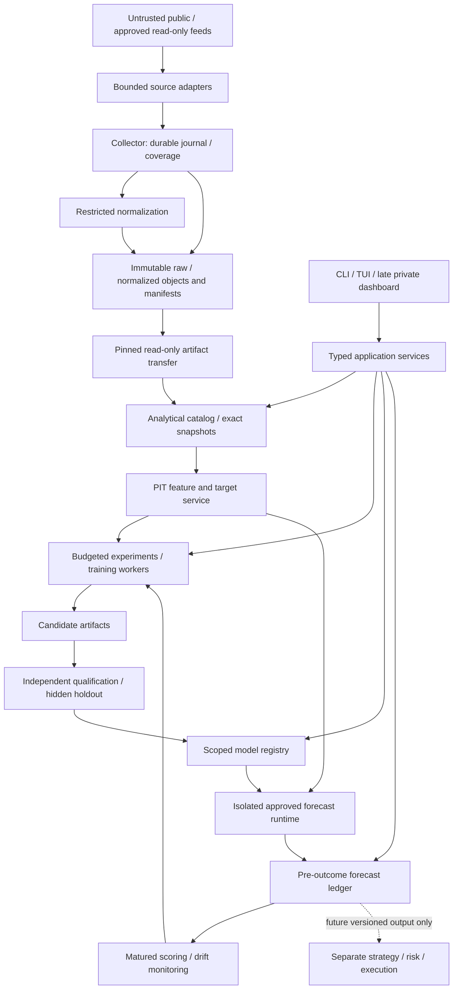

# Scryntic — Predictive Intelligence target architecture

Status: **architectural direction approved**, 2026-10-19. This is the target, not a claim of delivered functionality. Bounded M0 preparation was authorized and the [PI01 protective foundation](docs/architecture/PI01_PROTECTIVE_FOUNDATION.md), stopping before PI02 or fitting. [Policy v2](docs/architecture/PI00_RESEARCH_POLICY_v2.json) freezes the original scientific rules and admits only scoped Binance Vision historical reconstruction for private noncommercial research; Bybit rights, live-source rights and historical point-in-time availability remain pending independently. The approval/gate record and execution checkpoint track the limited gate. The opt-in preparation workflow reuses Foundation v1 accepted imports and immutable datasets. Neither a registered policy nor synthetic tests authorize fitting, real-source enrollment, financial execution or a predictive claim. PI00/PI01 final qualification and publication status are recorded separately.

See [current implementation](docs/research/CURRENT_STATE.md), the verbatim [historical Foundation plan](docs/architecture/history/FOUNDATION_V1_2026-09-14.md), [decisions](docs/architecture/DECISIONS.md) and [roadmap](docs/architecture/ROADMAP.md).

## 1. Objective and evidence

Maximize empirically validated forecasts of future returns, direction, magnitude and uncertainty. Start with **hours, days, weeks and longer horizons**; the proposed first set is 1 h, 1 d, 7 d and 28 d. Minute/second forecasting comes late. Trading is an independent post-core extension.

Success is measurable improvement over suitable baselines on genuinely unseen chronological data, with calibrated uncertainty and a pre-outcome prediction record. Model count, historical price fit and model complexity are not success criteria. A null result keeps the baseline champion. Platform completion does not require discovering profitable predictions or inventing positive results.

Durability, availability-time correctness, reproducibility and security are mandatory admission constraints. An improvement obtained by weakening them is inadmissible. Research, contradictory findings and limitations are retained in [academic evidence](docs/research/ACADEMIC_EVIDENCE.md), [Consensus records](docs/research/consensus/SEARCH_LOG.md), [reference source examinations](docs/research/REFERENCE_SYSTEMS.md) and [engineering evidence](docs/research/ENGINEERING_SECURITY.md).

## 2. Selected architecture and alternatives

Select a **modular Python application with separate collection, research, qualification and production-forecasting principals**, immutable artifact exchange and a small durable coordinator. Keep single-owner SQLite for operational metadata and Parquet/Arrow for analytical objects. Introduce native batch engines and enrolled CPU/GPU workers incrementally. Host brands are unrestricted; hosts must satisfy a declared eligibility and trust profile.

| Alternative | Benefits | Decision / reversal condition |
|---|---|---|
| Evolve current services, local metadata and immutable artifacts | Preserves implemented guarantees, Python ML integration, low operating burden and offline reproducibility | **Selected.** Separate authority through contracts/process identities without requiring a network service per module. |
| Central PostgreSQL, object storage and managed experiment services | Concurrent writers, shared access and availability options | Defer until measured concurrency, availability or artifact distribution requirements exceed the selected approach. Migrate metadata through ports; never share a live SQLite DB over a network filesystem. |
| Broker/microservices/Kubernetes and large Rust core | Potential high-throughput streams and fleet scheduling | Defer: migration and operational costs precede predictive evidence. Reconsider only against demonstrated bottlenecks and service objectives. |

[Decision records](docs/architecture/DECISIONS.md) define trade-offs; [Rust benchmarks](docs/research/RUST_BENCHMARKS.md) define measurements. No component rewrite is justified by language preference.

## 3. Boundaries and data flow

The collector runs continuously on Linux independently of a workstation. Analysis can run under another identity on the same host or remotely. Workers receive finite approved tasks and exact immutable inputs, with no collector database, operational secrets, registry-write or financial authority. A qualified local CPU worker is the mandatory baseline. Remote transport credentials belong to a narrow agent outside the model sandbox.

Extend the existing application/domain ports, dataset/replay/provider/job services and concrete composition. Avoid parallel state machines. ML frameworks stay out of collector/coordinator imports. Dashboard/API processes are optional clients; their failure cannot stop core services.

## 4. Data reliability and analytical storage

### Durable acceptance and recovery

Preserve raw payload bytes, source/ingestion identity, accepted offsets, producer/epoch, schema/codec and manifest chains. Durable acknowledgement follows the existing committed journal boundary, not queue insertion. Preserve bounded intake, explicit pressure policy, no-replace publication, file/directory durability, hash/length verification, conflict rejection and recovery convergence. Reconnection is not evidence of continuity. Coverage remains complete/pending/unknown/unrecoverable; later repair never rewrites earlier observations.

Keep the measured `parquet-pyarrow-v1` raw codec and existing readers. Compaction creates new objects/manifests and never mutates pinned bytes. Each operational DB has an explicit owner; research queries do not access the collector's writable journal.

### Availability and revisions

Distinguish event/valid time, source publication time if known, producer receipt with clock uncertainty, durable acceptance, archive publication and consumer-import availability. Unknown times remain unknown. Every recipe selects an availability plane: source-public, collector-observed or analysis-consumer-observed. Strict eligibility requires the latest plausible availability at that plane to precede the earliest plausible origin. Source event time alone is insufficient; later workstation import cannot prove earlier local availability.

Revisions retain stable fact identity, revision/supersedes identity, valid interval and knowledge interval. An as-of view chooses the latest fact actually known at the origin, with an explicit tie-breaker. Historical reconstruction, simulated as-observed replay and actual forward evidence stay distinct. Existing F18/F19 snapshots select revisions without reconstructing every earlier revision; a new PIT view must extend that capability without relabeling old evidence.

Macro data needs vintage/release information, not today's revised history ([FRED real-time periods](https://fred.stlouisfed.org/docs/api/fred/realtime_period.html)); date-level vintages cannot prove intraday release time. News requires first-seen, publication/edit and ingestion times, rights and deduplication. On-chain data requires block/reorg/finality and node/indexer availability. Missing historical availability limits qualification rather than receiving fabricated timestamps.

### Identity, coverage and families

Retain venue/category/native instrument identity. Add versioned cross-venue mappings for economic underlying, base/quote/settlement, spot/perpetual/dated future/option, multiplier, expiry, tick/lot and units. Mappings have effective and known times; a reused ticker is not stable identity. Continuous futures rolls and corporate actions are explicit if those markets are added. Universe membership includes delistings and historical eligibility.

| Family | Required policy; adapters added only when a research need justifies them |
|---|---|
| OHLCV / trades | Finality, interval/calendar, duplicate IDs, corrections, absent intervals, units and volume semantics. |
| Books | Documented snapshot/delta/sequence semantics, validity epochs, checksum if supported and reset/gap recovery. Invalid state cannot feed trusted features. |
| Derivatives / funding / OI / liquidations | Contract units, mark/index distinction, announced versus realized funding and source completeness/publication schedule. |
| On-chain | Chain identity, reorg/finality and historical node/indexer access. |
| News / text | First-seen/edit history, deduplication, rights, versioned embeddings and untrusted-content isolation. |
| Macro / external | Release vintages, revisions, delayed access and point-in-time calendars. |

Missing is not zero. Preserve reason masks, staleness and quality; distinguish no-trade intervals from missing collection. No unconditional backfill/forward fill. Imputation is a named train-fitted transform with a maximum age and missingness feature. Default qualification excludes unavailable evidence; exploratory permissive policies remain visible and unqualified.

### Storage and retention

Use immutable partitioned Parquet, bounded row groups, object indexes, Arrow batches and a rebuildable analytical catalog. Partition by family/venue/time with measured object-size targets. Snapshot manifests enumerate exact files, mappings, schemas, policies and dependencies; use manifest-resolved scans, not mutable globs. Preserve canonical numeric semantics at storage boundaries; model dtype/conversion is recorded.

Initially retain PyArrow and approved batch operators. Shortlist isolated DuckDB for application-owned PIT joins/projections; compare Polars as an alternative feature engine where measured benefits justify it. Do not require both new engines. Disable arbitrary SQL, network/external file access and extension loading; OS controls remain mandatory. Bound scratch/spill, threads, memory and cancellation. No shared writable DuckDB file is required ([concurrency model](https://duckdb.org/docs/current/connect/concurrency)).

Retention is an operator policy over raw/normalized/features/models/forecasts, legal rights and recovery horizons. Pins protect reproducibility; preview deletion, preserve trust anchors and record tombstones/missing dependencies. Validate training, derived-data, commercial-use, retention and redistribution rights before source/model admission. Reject sources incompatible with promised reproducibility unless a separately reviewed alternative is explicit. Object storage/table formats are optional measured-scale migrations.

## 5. Features, targets and contracts

Feature definitions are immutable recipes: operator/version, inputs, lookback, availability, universe/mappings, train-fitted state, dtype, missingness and output schema. Begin with returns/lags, volatility/range/volume, cross-sectional ranks and simple factors. Add other signal families through data-quality and ablation evidence. Batch and live paths execute the same definition and as-of semantics. Test parity, late revisions, calendars and train-state reuse. Incremental caches are disposable, keyed by recipe/input/watermark; corrections invalidate dependent ranges.

Targets declare log/simple/total return, observable reference price, endpoint, direction thresholds, units, duration/calendar, sampling and outcome availability. First crypto experiments use log close-to-close returns with positive valid prices, finalized origin bars and a declared observation delay. M1 first verifies source frequency/history and per-horizon sample feasibility, then adds bounded deterministic resampling and duration-based labels: the current 1–128-step/10,000-row replay contract cannot silently express weekly/monthly targets from minute bars. Add a fixed baseline fit/evaluate task on the existing verified launcher; current forecast-only providers are not assumed to support training. Derive price projections from reference price and return distribution; price-level accuracy is not return predictability. Auxiliary magnitude/volatility targets must earn inclusion through the registered objective.

Proposed versioned contracts (not changes to current v1):

| Contract | Required semantics |
|---|---|
| `DatasetSnapshot` / `FeatureSet` / `TargetSpec` | Exact manifest hashes, availability plane/cutoffs, universe/mappings, recipe/fit state, rights, quality/exclusion counts and schema. |
| `ExperimentSpec` / `TrainingTask` | Hypothesis family, development splits, budget, model/config/seed/environment hashes, objective, approved search space and stop rule. |
| `ForecastRequestV2` | Request ID, common origin interval, information cutoff, exact features, target/horizons, admitted release and deadline. Separate horizon duration/calendar from sampling frequency and step count. |
| `ForecastDistributionV2` | Expected/median return if supported, ordered quantiles or samples/distribution type, direction/magnitude probabilities, calibration version, units, quality, abstention and expiry. Unsupported outputs remain explicit. |
| `QualificationReport` / `ModelRelease` | Scope-specific baseline/skill/calibration evidence, holdout access, forward evidence, runtime/security eligibility, licenses and policy/signoff. |
| `ForecastPublished` / `OutcomeScore` | Immutable forecast bytes, trusted pre-outcome acceptance time, evidence class, matured scoring vintage and correction links. |

Reject nonfinite values, crossed quantiles, unnormalized probabilities and inconsistent horizons/targets; no silent sorting/clipping into acceptance. Preserve forecast-only authority and explicit v1 adapters. Separate backcasts, historical reconstruction, simulated as-observed and genuine forward evidence classes.

## 6. Reproducible research and evaluation

Register universe, periods/regimes, availability, horizons, baseline family, metrics, resource budget, meaningful improvement margin and stopping rule before search. Start with zero-return/random-walk price, train-only historical mean, regularized linear/AR and simple volatility-aware probabilistic baselines. Compare gradient boosting next; deep/foundation models face the same budgets and leakage checks. Ensemble weights use out-of-fold predictions and independent evaluation. Existing TimesFM is a candidate, not a privileged champion.

Use **global origin cutoffs across all assets**, not flattened panel-row splits. Training labels must be known before fit cutoff. Purge actual overlapping label/information intervals, conservatively including boundary-touching cases as F19 does. Define embargo from overlap/dependence rather than an arbitrary row count. Non-forward purged CV, if used for robustness, is separate from primary forward evaluation and must apply direction/overlap rules. [TimeSeriesSplit](https://scikit-learn.org/stable/modules/generated/sklearn.model_selection.TimeSeriesSplit.html) alone does not establish these semantics.

Nested rolling/expanding walk-forward development separates fitting, feature/hyperparameter selection and calibration. Fit preprocessing/regime classifiers only on permitted past data. Calibration uses matured out-of-fold or chronological calibration data, never the final test. Record all model/feature/seed attempts, failures and human/agent interventions by hypothesis family. Use predeclared multiple-testing control, dependence-aware intervals and trial budgets.

Reserve the genuinely uninspected final chronological period in M0 and establish a minimal append-only trial/access ledger before the first baseline fit or feature ablation. M1/M2 use development data only. M3 expands these controls into the full qualification registry; it cannot retroactively make inspected data untouched. Qualification evaluates frozen candidates through fixed interfaces; researchers cannot read final labels or alter scoring. If the reserved range was observed/consumed, disqualify it and choose later unseen data. Foundation training cutoffs/corpora may be unknown; tag contamination risk and rely on post-registration forward evidence for strong claims. A nominal cutoff does not prove independence.

Report by horizon/universe/regime with eligible/excluded/abstained counts: return MAE/RMSE and skill versus baselines; direction Brier/log score and calibration versus past base rates; quantile pinball/CRPS where supported; interval coverage **and width**; cross-sectional IC/rank IC only where appropriate. Include quiet markets, coverage and dependence. Abstention cannot hide failures.

Use paired time-block/bootstrap or justified dependence-adjusted tests, preserving same-origin cross-asset dependence. Report effects/uncertainty and sensitivity to splits, costs, revisions and regimes. Economic diagnostics use a preregistered simple exposure mapping with conservative fees/spread/funding/slippage; report gross/net assumptions. They are research diagnostics, not validated fills or trading authority. Do not tune strategy against qualification data.

Approve numeric margins, effective sample counts, calibration/coverage tolerance and resource ceilings per task before testing. No universal threshold is invented here. Longer-horizon forward evidence may require months/years. A valid negative result retains the baseline.

Record data/feature/target/split/model/lock/source/config hashes, seeds, hardware/driver and deterministic settings. Distinguish exact canonical replay, floating training repeatability and cross-device numerical tolerance. A seed alone is not reproducibility.

## 7. Qualification, registry and monitoring

Technical provider admission, scientific qualification and production promotion are separate. Registry states: experimental → technically verified → historically qualified → forward shadow → production approved → retired/revoked. Each state is scoped to universe, horizons, features, calibration, environment and policy. A worker's self-description grants no authority.

Initially the operator promotes frozen releases. Later bounded automatic promotion chooses only within preapproved families, environments, budgets and historical/forward policies. An independent service owns registry writes. Workers cannot modify production software, thresholds, credentials or permissions. Rollback selects a prior immutable release, never a mutable model file.

Record production/shadow forecasts durably before outcomes become observable. Late acceptance is labeled and excluded from genuine forward claims. Append matured outcomes and subsequent corrections separately, retaining first-available and revised score views. Hash chains detect tampering relative to retained anchors but cannot prove an administrator never backdated history. Strong public claims require independent timestamp/witness or externally retained checkpoints without exposing private data.

Monitor completeness/lateness, input freshness/coverage, covariate shift, matured residual loss, calibration/interval coverage, abstention and baseline-relative skill. Different horizons mature asynchronously; do not score immature labels or treat correlated observations as independent. Drift can pause inference, choose an approved baseline or queue a bounded retrain; it cannot authorize unqualified promotion. Debounce/budget retries and retrains; drill revocation and rollback.

## 8. CPU/GPU workers and bounded autonomy

Reuse F20 jobs and F21/F22 effective controls. First add local finite training/evaluation. Then enroll a remote agent using narrow authenticated task/artifact endpoints or pinned input transfer and quarantined output upload. Begin with one active coordinator/DB owner and restart recovery; transparent multi-coordinator HA is deferred.

A task manifest binds task/attempt/lease epoch, approved executable/environment digest, input hashes, schema, capability profile, seed, command template, output contract and CPU/GPU/RAM/disk/process/network/time quotas. Discovery reports architecture/runtime/accelerator/driver, memory, effective probes and expiry; operator enrollment decides eligibility. Self-reported capabilities are not attestation of honesty.

At-least-once dispatch needs expiring leases/heartbeats, fencing, bounded retry, actual-owner cancellation and idempotent acceptance. Expired work may still run: revoke acceptance authority and clean it through its owner. Verify current attempt, bindings, byte limits, safe path/type/schema and outputs before atomic acceptance. Stale/duplicate results cannot overwrite accepted objects. Hashes prove byte identity, not numerical truth; independently recompute baselines/samples and requalify promotion candidates on a trusted qualification host.

Workers receive read-only explicit inputs, private home/tmp/scratch, sanitized environment/descriptors, no ambient network/secrets, unprivileged identity, no-new-privileges, empty capabilities and resource/process/output/time limits. Fail closed on missing effective controls. Separate provisioning/transport agents use limited credentials before sandbox execution. Untrusted model-loading/native decoding remains isolated; custom-code checkpoints are not auto-admitted.

GPU has a distinct device/driver/runtime/memory/timeout profile and qualification. Host, kernel, firmware and driver remain trusted; device passthrough does not inherit CPU assurances. Unsupported hosts stay ineligible. Containers aid reproducible packaging but do not replace isolation. No Kubernetes, Ray, generic shell endpoint or worker-initiated dependency install is required.

Autonomy selects approved feature/model/data templates and bounded searches, records hypotheses, compute/money/storage/concurrency/time limits and stop conditions. News and external research are untrusted data. New code, dependencies, adapters, loading modes or privileges require a separately reviewed admission path. Researchers cannot weaken evaluation or inspect hidden holdouts. See [threat model](docs/architecture/THREAT_MODEL.md).

## 9. UX, operations and private dashboard

Preserve F24 typed services, shared workflow metadata/validation, bounded JSON/diagnostics, headless profiles and actual-owner cancellation. Guide users through **Data readiness → Dataset/targets → Baselines → Experiment → Qualification → Forward forecast → Monitoring**. Default to long horizons; progressively disclose availability, purging, budgets and calibration.

Comparisons show target/horizon, evidence class, same-period baselines, uncertainty/calibration, sample/exclusion counts, costs and versions. Explain unavailable output and corrective action through safe fixed errors. Distinguish local snapshot/live health, cancel-current-operation/job cancellation and technical admission/predictive qualification. Test service/CLI/TUI parity and operator journeys.

Near core completion add a separate private dashboard/API: VPN/private bind/firewall, strong authentication with MFA-capable provider or equivalent policy, per-action roles, sensitive-action reauthentication, CSRF/session controls, bounded requests/pagination/rates, safe rendering and audit. VPN membership alone is not authorization. Default read-only; grant job management and model promotion separately. No generic SQL/filesystem/shell/install endpoints. Dashboard/API/auth failure must not stop collection, scheduling or local CLI control.

Extend existing health/logging with data lag/coverage, journal/disk pressure, publication, lease/resource failures, model version, forecast lateness and matured skill/calibration. Exclude secrets/private raw content from telemetry. Exporters/extra infrastructure follow concrete operational need. Qualify Linux/filesystem/CPU/GPU profiles, locks and effective controls. Preserve restart, trust anchors, backup/restore, upgrade/rollback and retention pins. Set capacity/SLOs from measurements.

Under the operator's subsequent roadmap-consolidation instruction, the Foundation project and unfinished F25–F30 are Canceled as superseded, with original scope/history preserved. All 45 Done issues remain unchanged. Applicable reporting/deployment/retention, extension and release gates are explicitly carried into PI17, PI18 and PI21; Telegram remains optional/deferred. This does not claim Foundation release completion. See the [disposition ledger](docs/architecture/ROADMAP.md#foundation-disposition-after-operator-follow-up).

The optional [AI-agnostic MCP adapter](docs/architecture/MCP.md) is another late interface over the same typed application facade, not a new scheduler or source of business rules. Default read-only tools/resources expose authorized health, catalogs, released forecasts and evidence; preauthorized operational tools submit/cancel bounded jobs. Narrow configuration changes use validated previews and independent server-bound human approval. No SQL/filesystem/shell/code, credential, security-policy, sealed-holdout, model-promotion or trading authority is exposed. MCP process/disconnect/auth failure cannot stop core services.

Plan its small transport-neutral contract as a non-blocking M3 branch after admitted training; implement stdio and authenticated private Streamable HTTP profiles in M7 alongside shared API/management, then qualify actual clients and optional hosted bridges. The researched current protocol is 2026-07-28; older client profiles require explicit compatibility testing. MCP does not add a prerequisite to M1 or the PI21 prediction-core gate. [ADR-PI-009](docs/architecture/DECISIONS.md#adr-pi-009--optional-ai-agnostic-mcp-over-shared-application-services) and the [source ledger](docs/research/MCP_EVIDENCE.md) explain transport, SDK and client limits.

## 10. Compatibility and sequencing

Never rewrite v1 archives/datasets/forecasts in place. Preserve identities, chains, anchors, canonical numeric semantics and old readers. Add explicit v2 schemas and adaptation fixtures; unknown major versions fail closed. New manifests may reference old objects plus honest unknown metadata. Retention pins/job recovery survive upgrades; do not assume data can be recollected. [Migration plan](docs/architecture/MIGRATION.md) defines compatibility, shadow rollout and rollback.

The [roadmap](docs/architecture/ROADMAP.md) starts with returns/baselines/forward ledger, then PIT signals, controlled model comparisons, flexible workers and autonomy, then operational maturity/private dashboard and the prediction-core gate. Minute/second extensions follow the core gate. Trading follows the gate with independent authorization: [future trading design](docs/architecture/FUTURE_TRADING.md).

Before implementation approval, choose initial universe/data rights, resource envelope, registered numeric evaluation policy and first milestone scope. Before production promotion, require availability/leakage/reproducibility/security checks, historical and forward gates, rollback evidence and operator approval. No architecture document establishes predictive advantage, profitable trading or universal containment.
