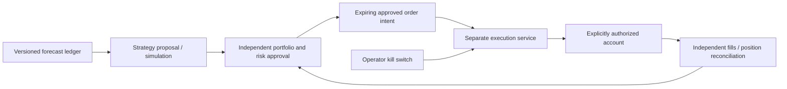

# Future trading extension — design only

Status: deferred, not an implementation authorization. This extension starts only after the prediction core completion gate in [ROADMAP.md](ROADMAP.md). It is not a prerequisite for that gate. No active order-placement adapter, trading credential or account authority is introduced by the prediction program.

## Boundaries

Forecast producers publish estimates and uncertainty, never imperative orders. A versioned `ForecastPublished` contract contains exact forecast/model/data/policy identities, origin, horizon, expiry, quality, abstention and evidence class. The forecasting principal cannot access account secrets, call execution methods, change risk limits or enable live mode.

A future strategy principal translates forecasts to proposed exposures using explicit capital, costs, liquidity and turnover assumptions. An independent risk service checks exposure/concentration/leverage, instrument eligibility, liquidity, price bands, stale forecasts, venue/account health, maximum loss/drawdown and order/position limits. Risk approval is a short-lived intent bound to account, instrument, side, quantity, price constraints and idempotency identity; it is not a reusable authority token.

The executor alone owns minimal account credentials. Disable withdrawals/transfers at the venue; use account/subaccount scoping and IP restrictions when supported. Venue-enforced permissions supplement service controls. Risk or model compromise must not grant new credentials or limits. Executor reconciliation and local durable state handle unknown outcomes, duplicate requests, partial fills, exchange restarts, cancel/replace races and account divergence; uncertain submission is reconciled before retry.

## Sequencing and qualification

1. Deterministic strategy simulation with an independently checked ledger; explicit fees, funding, slippage, liquidity, delistings and corporate actions where relevant. Candle simulation cannot prove intrabar fill order.
2. Paper/shadow execution against recorded/live public data, with no trading keys, followed by a distinct operator-approved account integration design.
3. Separately authorized limited live pilot after risk review, legal/data-license review, recovery drills and operator sign-off. Nothing in the current roadmap authorizes this step.

Kill switches operate independently of the dashboard and forecasting service. Define whether a trigger cancels working orders, freezes new orders or requests position reduction; flattening is itself execution and needs an explicit policy. Fail closed on stale risk state, ambiguous account position, exhausted limits, lost supervision or unrecognized intent version. Durable audit binds forecast→strategy→risk approval→intent→submission→venue acknowledgement→fills/reconciliation. Never infer a fill from a successful request alone.

A trading or dashboard outage cannot stop collection, invalidate the immutable forecast ledger or grant the forecasting system account authority. Forecasting APIs remain useful with the entire trading deployment absent.
