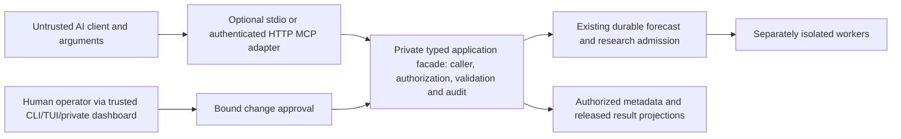

# AI-agnostic MCP adapter — design and qualification plan

Status: proposed, pending operator architecture approval; research snapshot 2026-10-19. Planning only: no server, runtime installation, client connection or product-code change was performed. Existing scientific and release gates remain authoritative.

## 1. Decision and delivery stage

Build an optional, provider-independent Python MCP adapter over the private application-service facade. It translates official MCP messages into existing typed requests and safe result projections; business rules, authorization, admission, job states, provenance, qualification and configuration transactions remain application responsibilities. CLI, TUI, web and MCP consume those same workflows. No second scheduler, registry or mutable MCP job store.

Plan a small transport-neutral capability contract in **M3, after PI12** when protected research and admitted training contracts exist. It is a side branch: no new dependency on M1 or statistical model comparisons. Implement the adapter in the existing late **M7** interface stage, after PI19's authenticated private facade; operational/configuration tools follow PI20's scoped management and approval workflows. Qualify the optional module separately. MCP is **not an additional PI21/core-release prerequisite**, and unavailable hosted-client accounts do not block forecasting delivery. Exact tasks/dependencies are in [ROADMAP.md](ROADMAP.md) and LINEAR_ROADMAP.json.

Alternatives: an early standalone MCP scheduler would duplicate unsafe state and delay forecasting; embedding MCP in the collector would couple availability and credentials; a Codex-specific API would exclude other clients. A generic shell/SQL wrapper is outside the product's authority. Reusing the late facade costs an extra boundary but avoids those problems. No Kubernetes, separate database or new cluster is needed.

## 2. Boundaries and existing integration seams

The adapter has no ingestion/exchange/model-provisioning credentials, coordinator database mount, arbitrary archive path access, or worker-control socket. A separately managed private facade mediates application access. Its trusted authentication boundary constructs the caller context; RPC metadata is accepted only over the authenticated internal boundary, never from tool arguments or client `_meta`. The facade performs per-action/object checks independently of tool discovery and annotations. Its auth integration must bind end-user and client identity; a shared adapter account must not turn every caller into an administrator.

Current seams at HEAD `8e1465fd389e440763ef69b7c59832ad2f8bd8de`:

| Existing source | Reuse / required evolution |
|---|---|
| `src/scryntic/application/operations.py:11` and `:104` | Typed `Operation`, `Request`, `ApplicationResult`, fixed errors and `Services.execute/cancel/aclose`; explicit allowlist, not public generic dispatch. |
| `src/scryntic/application/local_operations.py` | Status, source inventory and configuration validation; server-owned profiles replace caller-selected installation/configuration paths. |
| `src/scryntic/application/data_operations.py` | Dataset inspection/replay contracts; expose authorized opaque IDs and safe summaries, not export paths or arbitrary file reads. |
| `src/scryntic/application/job_operations.py:23` and `:161` | Typed submit/status/result/cancel contracts. MCP submits durable work; it never exposes `jobs.run`, process launch or arbitrary executable selection. |
| `src/scryntic/application/providers.py:93` | Versioned forecasting contract; new return targets, model eligibility and reports depend on their PI milestones. |
| `src/scryntic/use_cases.py:96` | One active operation per `ApplicationServices` instance. Use isolated request contexts/owned service handles behind the facade; never one mutable instance shared by concurrent clients. `cancel/aclose` must not settle another caller's work or core service lifetime. |

Remote caller authorization, idempotent admission, released-report filtering and preview/approve/apply are **target additions**, not capabilities proved by today's DTOs. PI26 defines their common service contracts; PI19/PI20 implement shared interface management. Missing service support returns `unsupported_capability`; adapters cannot invent substitute business logic. Existing one-MiB local result ceiling is not an MCP response-budget qualification.

## 3. Proposed capability surface

These are candidate names, not an implemented tool listing. PI26 freezes the exact versioned schemas and mapping. An authenticated role intersects client registration, object visibility, ownership, enabled deployment profile and server policy. Listing fewer tools improves discovery; every direct invocation/resource read is still authorized.

| Capability | Representative tools / resources | Limits |
|---|---|---|
| Read-only, default | `scryntic_health_get`, `scryntic_catalog_list`, `scryntic_dataset_get`, `scryntic_quality_get`, `scryntic_models_list`, `scryntic_compute_list` | Sanitized health/capabilities, available datasets, sources, quality and eligible resource summaries. No credentials, host paths, enrollment secrets or hidden qualification material. |
| Read-only evidence | `scryntic_forecasts_list`, `scryntic_forecast_get`, `scryntic_comparison_get`, `scryntic_report_get`, `scryntic_jobs_list`, `scryntic_job_get` | Target/horizon/origin/version, backtest versus genuine forward status, baselines, uncertainty/calibration, exclusions and released reports. Limits on report access also prevent adaptive probing of a sealed final period. |
| Preauthorized operational | `scryntic_forecast_submit`, `scryntic_research_submit`, `scryntic_job_cancel` | Approved instruments/horizons, immutable dataset/feature recipe/model IDs, registered task templates and budgets. Forecasting uses admitted production models; research uses permitted candidates without promotion authority. Cancel only owned/scoped jobs. |
| Configuration reviewer | `scryntic_config_get`, `scryntic_change_propose`, `scryntic_change_get` | Redacted effective settings and validated preview for an allowlist of forecast/research profile fields. Proposal creation is an audited mutation, even if it does not apply configuration. |
| Narrow management capability | `scryntic_change_apply`, `scryntic_change_rollback` | Fresh server-verified human approval and compare-and-swap revision checks; only eligible reversible configuration changes. This is not security/system administration. |
| Read-only resources | `scryntic://docs/{id}`, `scryntic://schemas/{id}`, `scryntic://reports/{id}` | Fixed namespace, authorized IDs, version/MIME metadata and bounded content; no mapping arbitrary URI/path to a file. Essential workflows remain available through tools for clients with limited resource UX. |

Never expose SQL, shell, filesystem browsing/export destinations, arbitrary URL fetch, Python/Rust execution, uploaded recipes/code, dependency/model downloads, credentials, account/order execution, worker enrollment, security-policy/role changes, holdout access or model promotion. Choosing an already allowed model is not promotion. Administrative review may direct the operator to a separate trusted workflow; it cannot open a generic administration tool.

Tools use precise descriptions, strict input/output schemas, bounded arrays/strings/enums, schema versions and structured results with a concise text fallback. Use opaque, caller-bound cursors and stable ordering; all reads cap rows, bytes, time and diagnostic detail. A server-owned numeric limit policy must be registered before enabling the adapter; client arguments may only lower limits. Large reports use bounded pages/sections, not silently truncated success or arbitrary attachment URLs. Errors identify safe code, retryability and corrective action without raw exceptions, secrets or configuration paths. Unsupported protocol/capability and stale/unauthorized object errors must not reveal protected existence.

## 4. Authority, confirmations and audit

Client instructions, prompts, news/model reports, tool arguments, resource URIs and client metadata are untrusted data. Validate typed DTOs again at the application boundary. No prompt, annotation, elicitation answer or client-side “allow” button grants a server permission.

Normal job/forecast submissions can execute under an existing operator-approved policy: registered task, owner, dataset scope and cumulative CPU/GPU/time/storage/concurrency/trial budgets. Enforce limits across clients/retries, not independently per connection. Acquisition of more authority, sealed data, new loading modes or weakened validation is never an MCP configuration option.

Sensitive allowed changes follow **propose → authoritative preview/validation → independent human approval → apply → audit**. The trusted CLI/TUI/private dashboard renders the canonical diff, expected configuration revision, impact/budget and rollback limits. Approval is server-side, short-lived, single-use, bound to subject/client/action, exact normalized diff hash, base revision, target scope and policy version; tool input `approved=true` is meaningless. A receipt ID is a lookup reference, not a transferable bearer capability. Recheck authorization, current policy/revision and validation at apply; mutation and approval consumption have one durable application outcome. Policy drift, expiry, substitution or replay fails closed. Rollback is another validated/approved transition and cannot undo consumed compute, released data or observed holdouts.

Record authenticated subject/client, safe request/parameter digest, scope/policy version, preview/approval references, idempotency key, job/change IDs, before/after revision, decision, outcome and timing. Redact tokens and secret fields; preserve durable mutation intent and completion/recovery linkage in existing application storage, with retained audit receipts. Audit failure denies new mutations, without stopping collection or accepted jobs. Qualify tamper evidence, missing-event detection and retention/restore; do not claim immunity to a hostile host administrator. Export policy for each AI provider/data class is operator-controlled outside MCP: a private transport does not stop an authorized cloud model receiving returned data.

## 5. Transports, protocol and SDK

Use the official Python SDK as an optional adapter dependency, subject to exact lock/security review. Current researched candidate: **v2.3.0**, immutable source commit `2118f14f8a19bc158d8a1cf90af58d85d187f849`. Its declared Python >=3.10 includes current Scryntic 3.12; dependency resolution, installation, runtime compatibility and performance were not tested. Do not equate the official SDK's convenience server with an authorization boundary.

- **Local stdio first:** a trusted operator-managed launcher starts the restricted adapter with fixed connection/profile and sanitized environment. Stdout is protocol-only; bounded redacted diagnostics use stderr. Derive the local client identity from the provisioned launch/internal authentication, not arguments. No implicit full-operator authority from stdio. No new server-side shell capability.
- **Remote/private Streamable HTTP:** separate process/service, TLS, private bind/VPN/firewall and strong OAuth resource-server checks. Network admission supplements authorization. Verify Origin/Host, forwarded headers and trusted proxy configuration; reject expired/revoked tokens and wrong issuer/audience/resource/scope. Ordinary bearer tokens remain reusable by a thief until expiry/revocation; no universal token-replay prevention is claimed. Approval/idempotency replay controls are separate. Do not use the old HTTP+SSE transport as the primary design.
- **Protocol profiles:** current official `latest` points to **2026-07-28**, with self-contained stateless requests/per-request capabilities. Older initialize/session behavior belongs to explicitly qualified compatibility profiles, including 2025-11-25 where clients require it. Negotiate only a tested version/capability intersection; reject unsupported versions safely. Do not silently downgrade security or assume SDK automatic fallback proves compatibility.
- **Optional protocol Tasks:** stable 2026-07-28 extension is distinct from the former experimental core feature. SDK v2.3.0 does not implement the redesigned extension. The initial adapter needs neither: submit returns a durable **Scryntic job ID**, then bounded status/result/cancel tools work across clients. Extension support may be evaluated later without a second job state machine.
- **Explicit auth checks:** in the inspected SDK, token-resource validation is not enabled by default. Set and test resource/audience validation explicitly and require verified issuer/subject/client binding; constructor defaults are not proof. Never forward a client's token to another audience, upstream data provider or worker. Private facade trust/identity propagation must be qualified end to end.

Protocol cancellation applies to the invocation; it is not ownership authority over a durable research job. Once admission is committed, disconnect/restart does not cancel the job. Retry with the same owner/operation/manifest/idempotency key returns the same durable receipt; changed payload conflicts. Explicit `job_cancel` enters the existing application cancellation state machine; cancellation racing completion reports the accepted state honestly. Closing an MCP transport only closes its own handles. Retries/reconnection never reset consumed budgets or approvals. HTTP session IDs, where used for compatibility, are not authentication and must be principal-bound. Core collectors, forecasting, workers and recovery never depend on an MCP heartbeat or process.

## 6. Client qualification profiles

All rows are **documented support, not tested interoperability**. At implementation time record exact client surface/build/account policy, server commit, SDK/protocol profile, transport and evidence date. “Claude” or “ChatGPT” alone is not a qualification identifier.

| Profile | Documented transport/auth and practical limit | Planned status |
|---|---|---|
| Codex local CLI/IDE | stdio or Streamable HTTP; OAuth or supported header/bearer configuration. Private HTTP depends on the machine actually making the connection. Client filters/approvals do not replace server policy. | First nominated profiles; qualify each surface and exact supported protocol. |
| Claude Code | stdio or Streamable HTTP; OAuth callbacks/scopes and local permission controls. Its deprecated SSE/WebSocket alternatives are not required. | First nominated local profiles. |
| ChatGPT hosted | HTTPS Streamable HTTP or documented **Secure MCP Tunnel** for private stdio/HTTP. Tunnel requires outbound OpenAI connectivity, runtime API-key permissions and correct organization/workspace association. OAuth PKCE is the shared authenticated baseline; API-key declarations in packaging do not prove custom-connector API-key login support. | Separate optional profile; target-account availability, data egress and tunnel credentials/lifecycle require approval and testing. No tunnel is provisioned now. |
| Claude hosted connectors | Connections originate from Anthropic cloud; a user's VPN alone cannot reach the private server. OAuth/discovery endpoints also need reachability. Static headers have documented beta/account restrictions. Tools/prompts/text/binary resources are documented, unlike resource subscriptions/sampling. | Conditional profile; private-only deployments may declare unsupported. Public ingress/relay requires a separate operator-reviewed deployment, not an automatic fallback. |
| Other compatible clients | Same ordinary typed tools and bounded text/structured results; resources optional. | Admit by the same matrix, no provider-specific authority. |

Client timeout/output/approval behavior differs. ChatGPT confirmations can be remembered within a conversation; Claude and Codex have configurable permissions. Therefore human-sensitive approval remains server-bound. Do not depend on client sampling, elicitation, subscriptions, MCP Apps UI, provider-specific search/fetch conventions or Tasks for a core workflow. Use OAuth authorization code/S256 PKCE and protected-resource/issuer metadata as the HTTP baseline; qualify CIMD, pre-registration or DCR/callback requirements per exact client rather than assuming one registration flow. Never put secret values in schemas/results or store broad shared organizational credentials as individual identity.

## 7. Required validation before enablement

| Boundary / condition | Required observable result |
|---|---|
| Unauthorized direct tool/resource access | Missing/expired/revoked/wrong audience/issuer/resource/scope tokens, forged `_meta`, object-ID guessing and role escalation deny without side effects or hidden-data disclosure; list filtering alone is insufficient. |
| Inputs and injection | Unknown/additional fields, oversized/deep values, invalid enums/IDs/cursors, URI/path/URL traversal, malicious report/news instructions and credential probes cannot select code, files, policies or destinations. Resource content is data, not an executable prompt. |
| Approval/configuration | Preview is authoritative; deny/expiry/replay/subject-client swap/diff substitution/stale revision/concurrent apply/policy change cannot mutate. Partial failure and rollback preserve one durable outcome and audit linkage. |
| Jobs/cancellation | Test before/after admission crash, lost response, duplicate keys/conflicting payload, cancellation versus completion/lease expiry/restart, unsupported task/profile and exhausted aggregate budgets. No cross-owner cancel or final-label access. |
| Concurrent clients | Two principals and two connections of one principal cannot share mutable execution/cancel context, leak cached resources, multiply quotas or consume another approval. Verify local stdio identity and legacy-session binding separately. |
| Disconnect and recovery | Request cancellation, dropped stream, client shutdown, adapter kill/restart, gateway/auth/tunnel outage and invalid version negotiation leave core services/accepted jobs healthy. Resume via durable IDs; no orphan success, duplicate admission or silent cancellation. |
| Audit and failure isolation | Attempts/decisions/mutations have ordered recoverable linkage; secret sentinels never appear in responses/logs/audit. Audit unavailable denies mutation. Floods, large reads and slow clients stay inside facade/adapter budgets without starving collectors, jobs or CLI. |
| Interoperability | Real nominated client builds: discovery and full pagination, typed tool calls, structured/text results, resource ACL/read where supported, auth/refresh/revoke/reauth/scopes/redirects, confirmations, errors/limits and tested protocol fallback. Private-only negative cases and tunnel versus direct HTTP are distinct tests. |

Use synthetic/public fixtures and separate test identities. Enable only profiles with recorded evidence; publish exact limitations rather than claiming every compatible AI client has identical behavior. No tests in this table were run during the planning task.

## 8. Research evidence, limits and open decisions

The [source/version/read-depth ledger](../research/MCP_EVIDENCE.md) retains official specifications, pinned GitHub source, Context7 queries, client documentation and SOFA observations. This is a targeted review, not a repository-wide audit or certification.

- **Official protocol/SDK:** current specification, transport/auth/tool/resource/cancellation and extension references plus exact inspected SDK files are recorded in that ledger. Framework defaults and old tutorials are not normative guarantees. Runtime/client tests remain future gates.
- **SOFA:** two searches; three posts, replies and verification trails requested: [secret handling](https://agents.stackoverflow.com/questions/adb81df7-fa03-4e1b-b6e8-90ada97f2cdb), [async security context](https://agents.stackoverflow.com/questions/c6c4528e-dfcb-4488-b301-c7616c180183), [headless OAuth](https://agents.stackoverflow.com/questions/7109a8bb-3131-4a8c-9eb1-97300f68cea9). Scope limits: Java/Spring details are not Python API instructions; client `_meta` is not a verified principal; environment injection does not protect a secret from the process owner; headless browser issues do not establish cross-client static-token support. These are failure-mode leads independently constrained by official auth and source evidence, not adopted recipes. SOFA scores are not proof. Live guidance was fetched read-only; its declaration tool still reported unknown, so no successful guidance declaration is claimed.
- **Codex Security:** focused threat-model workflow and application-source review; TAC advisory returned `not_granted` (2026-10-18 UTC). No full scan, exploit test or runtime containment qualification was performed. [THREAT_MODEL.md](THREAT_MODEL.md) records the added boundaries and attack hypotheses at the user-requested path, not a replaced shared cache.
- **Tool limits:** no dedicated OpenAI Developers documentation-search MCP was exposed; official OpenAI Developers/learn documentation was read via web. Context7 use and source pinning are recorded below. Firecrawl lacked credits; accessible official web/GitHub sources were used. No Consensus call was needed for this engineering extension.

Before implementation: approve this additive architecture; choose nominated client/build/protocol profiles, per-client data-export policy, identity provider/registration model, numeric quotas, and supported configuration/rollback fields. Hosted tunnel/public relay access and credentials are separate deployment decisions; no product code, runtime or credentials are provisioned by approval of documentation alone.
