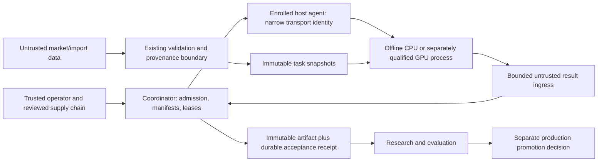

# Predictive compute threat model

Reviewed: 2026-10-18. Baseline source: `8e1465fd389e440763ef69b7c59832ad2f8bd8de`.
Scope: current local job/model-worker boundary and the proposed distributed predictive-compute architecture. This is an architecture review and reusable proposal, not a full repository security scan, validated finding list or host qualification. Related evidence: [engineering/security research](../research/ENGINEERING_SECURITY.md).

## 1. Overview

Scryntic retains a Python coordinator that admits reproducible data/feature/model/evaluation work, preserves provenance and owns durable result acceptance. The proposal extends local execution to any explicitly enrolled host eligible for the chosen task/profile. Workers pull leases; compute runs offline with no credentials. Hourly, daily and weekly forecasting is the initial research scope. Research artifacts, runtime qualification, production forecasts and any later trading system remain separate authority domains.

| Component | Current evidence or proposed responsibility |
| --- | --- |
| Durable job store and service | Current conditional claim/attempt token and success acceptance: `src/scryntic/jobs/store.py:264`, `src/scryntic/jobs/store.py:293`; `src/scryntic/jobs/service.py:103`. |
| Fixed local CPU launcher | Current operator-owned systemd command, mounts, environment and lifecycle: `src/scryntic/model_worker/launcher.py:73`, `src/scryntic/model_worker/launcher.py:323`, `src/scryntic/model_worker/launcher.py:398`. |
| CPU isolation profiles | Current fixed synthetic/native profiles: `src/scryntic/model_worker/profile.py:32`, `src/scryntic/model_worker/profile.py:123`. |
| Result ingress | Current bounded no-follow stable regular-file read: `src/scryntic/model_worker/output.py:9`; coordinator independently decodes and validates before durable success. |
| Distributed admission/scheduler/host agent | Proposed. The coordinator owns identities, manifests, budget reservations, leases and acceptance. A trusted networked agent launches only approved offline profiles. |
| Feature, model and scoring processes | Proposed task separation: immutable scoped input snapshots, no raw catalog authority, bounded outputs; final holdout scoring remains under coordinator-controlled policy. |
| Artifact and experiment catalog | Preserve immutable publication and recoverable accepted-state semantics; add manifest/profile/host evidence to proposed compute receipts. |

The diagram describes logical boundaries, not deployed network services. Host administrators can observe or alter work on their machines. Enrolling a host does not make its numerical claims true or hide input data from its owner.

### Effective resources and capability ownership

| Deployment or workflow | Resource or capability | Configuration and precedence | Safe effective value or location | Readers, writers or recipients | Enforcing control | Evidence or unknowns |
| --- | --- | --- | --- | --- | --- | --- |
| Current synthetic CPU | Process identity, mounts and execution | Fixed application profile; job cannot supply unit properties | Generated private root; selected interpreter/application/system-library binds; `/input/request`, `/control`; private scratch/home/output | Trusted bootstrap and fixture process; no general host home/config/socket mount | System manager DynamicUser/namespaces/read-only binds, privilege and resource controls plus effective verification | `src/scryntic/model_worker/launcher.py:73`, `src/scryntic/model_worker/launcher.py:323`; `src/scryntic/model_worker/profile.py:32`. Actual host qualification is distinct from source settings. |
| Current native CPU | Model/runtime and resource expansion | Registered model/bundle selects fixed `f22-cpu-v1`; local admission required | Adds `/model` and `/runtime`; cgroup memory 4 GiB, address space 8 GiB, CPU 90 s, wall 180 s, tasks 8, NOFILE 64, NPROC 8 | Registered native CPU runtime and adapter | Fixed profile; offline environment; OMP/MKL/OpenBLAS counts one; effective-control and bounded usage checks | `src/scryntic/model_worker/profile.py:136`; `src/scryntic/model_worker/launcher.py:282`, `src/scryntic/model_worker/launcher.py:445`; [F22 report](../validation/F22_VALIDATION.md) is historical host evidence. |
| Current launch environment | Credentials, descriptors and network | Launcher builds allowlisted environment, strips manager variables, starts child with empty inherited environment | Fixed HOME/TMPDIR/PATH/locale and profile-only offline/runtime controls; no application/exchange credential | Worker only receives its task request and explicitly mounted inputs | `env={}`, `close_fds=True`, isolated Python, private network and runtime control validation | `src/scryntic/model_worker/launcher.py:73`, `src/scryntic/model_worker/launcher.py:398`; property declarations alone do not prove every effective control. |
| Current result import | Worker-created filesystem object and bytes | Fixed result filename relative to pinned output directory; no worker-selected import path | `result.json` bounded by profile output limit; primitive correlated wire response | Bootstrap reads; coordinator independently validates | No-follow/nonblocking descriptor, same UID/regular/single-link checks and stable bounded read; current-attempt success transaction | `src/scryntic/model_worker/output.py:9`; `src/scryntic/jobs/service.py:103`; `src/scryntic/jobs/store.py:293`. Artifact before durable success can leave an unaccepted orphan. |
| Proposed remote host transport | Coordinator API, enrollment secret and allowed object transfer | Operator enrolls host and profile; agent-only scoped identity; coordinator validates destination/digest/size | Coordinator-approved endpoints and immutable admitted objects only | Trusted host agent; model/analytics child receives neither transport key nor broker socket | Authenticated channel, per-host authorization, revocation, API quotas and output caps; no worker-provided URLs | Design requirement; endpoint/auth/provisioning implementation not present in this review. |
| Proposed offline analytics/model | CPU, memory, scratch, processes, output, network | Admitted task binds fixed profile/runtime and resource budgets | Private writable scratch/output; explicit read-only snapshots; no external network, credentials or coordinator database | One admitted workload per isolation unit | OS-enforced boundaries and effective probes; trusted host agent controls launch; admission rejects missing controls | Design requirement; DuckDB/Polars/Rust profiles need separate implementation and qualification. |
| Proposed GPU task | GPU device, runtime, VRAM and device state | Separate eligibility and profile, never a fallback from failed CPU isolation | Only admitted device nodes/runtime; bounded host resources and declared VRAM policy | GPU workload and trusted driver/runtime | Host qualification, timeouts/cleanup, device access policy and a selected isolation strategy | Unqualified here. Driver/kernel/device sharing remain TCB and residual risks; CPU evidence does not transfer. |
| Proposed supply-chain intake | Executable model, wheel, extension or Rust artifact | Operator-reviewed acquisition/build outside execution; immutable digest inventory before admission | Versioned code/runtime/model/config/preprocessor bundle | Trusted build/review step; isolated execution consumes fixed result | Hash-constrained provenance, dependency review, vulnerability checks, reproducible build evidence where feasible | Hashes prove identity relative to inventory, not benign intent. No automatic extensions, remote-code trust or runtime downloads. |

Material code paths were graph-discovered and directly inspected; policy and validation documents were read directly. Coverage metadata reported no recorded gap for the material paths at generation `2026-10-18T17:01:25Z`; this is not exhaustive audit coverage.

## 2. Threat model, trust boundaries and assumptions

### Assets and objectives

Protect source and dataset provenance, immutable task identities, temporal validation boundaries, model/runtime inventories, accepted numerical artifacts, private datasets, coordinator state and credentials, host availability and audit history. Preserve a distinction between accepted forecast output and financial action: neither the current provider contract nor this proposed worker system receives order/account/withdrawal authority.

Required invariants:

1. Only the coordinator can admit work, grant a current attempt or accept success. A worker cannot choose executable code, raise its budget, alter the manifest, approve a model or mint another task.
2. A host agent may transfer admitted objects and submit a result for its own current attempt. Its credential and network authority never enter the child process, environment, image, logs or shared broker socket.
3. Input objects are verified, bounded and snapshotted before use. File, SQL and native-decoder input remain untrusted even when a transport is authenticated. Hashes establish byte identity, not market truth or parser safety.
4. Every acceptance binds task/run identity, immutable manifest, profile/runtime, current fencing value/token, host identity and revocation/cancellation/deadline state. Stale, duplicated or conflicting submissions cannot change a completed logical outcome.
5. Resource exhaustion is bounded by admission and OS enforcement. Failed, interrupted or unqualified work cannot be converted into a successful zero metric or silent exclusion.
6. Features, labels and learned preprocessing obey information-availability cutoffs; final holdout membership/scoring policy is not chosen by the model or after viewing outcomes.
7. Research cannot automatically become production, and production forecasting cannot automatically acquire trading authority.

### Actors and starting capabilities

| Actor | Initially controls | Does not initially possess |
| --- | --- | --- |
| External data producer | Payload values, timestamps, descriptors and potentially crafted files; can withhold or revise data | Coordinator credentials, installation or accepted-history rewrite authority |
| Model/dependency author | Candidate executable/native code, weights, metadata or an extension that might be proposed for intake | Automatic admission, runtime downloads, host management or financial credentials |
| Faulty or malicious compute process | Its scoped input view, private scratch/output and returned bytes; can hang, crash or fabricate plausible values | Host-agent transport key, network/socket access, coordinator state, admission or acceptance authority |
| Faulty or malicious enrolled host | Transport identity scoped to that host; can delay/replay responses, lie about capability and control local execution | Coordinator signing/enrollment authority, another host's identity, accepted-state mutation rights |
| Unenrolled network actor | Can attempt traffic, denial of service and captured-message replay under the eventual deployment exposure | Valid host identity or authorized object/result API access |
| Trusted operator/build/coordinator | Owns enrollment, approved runtime, policy, secrets and durable acceptance | Outside the worker-escape adversary model; its compromise remains a major residual risk |

Host-root compromise is not a worker sandbox escape prerequisite to assume silently. A malicious host administrator already controls that host: the meaningful remaining boundary is whether forged results can become accepted truth or leak data/authority beyond its admitted scope. Confidential inputs must stay on trusted hosts or use a separately designed confidentiality mechanism; this proposal does not hide plaintext from a participating host owner.

### Scheduling and authority contract (proposed)

Use pull leases from one authoritative scheduler state. Admission checks task type, provenance/availability, data/model rights, profile/runtime digest and resource budget; eligible idle capacity requests a bounded claim. A conditional transaction creates the attempt/history and advances a monotonic fencing value. Renew only a still-current attempt; expiration explicitly changes reclaimability. Worker clocks and a heartbeat do not grant ownership.

Cancellation, timeout, host revocation and scheduler recovery invalidate acceptance authority. Reassignment can overlap old physical computation; at-most-once accepted logical outcome is the invariant. A new coordinator epoch/recovery protocol must prevent reused fencing values and competing writers. Exact replay returns the durable existing receipt, while a different digest for the same logical completion is a conflict. Artifact promotion, durable completion and restart reconciliation must account for failure between each operation. An artifact with no accepted receipt remains unaccepted.

### Assumptions, exclusions and unresolved deployment controls

The kernel, systemd/launcher, identity allocator, native runtime and selected libraries form the local TCB; GPU adds its driver/runtime and device behavior. Current qualification is specific to its retained host/revision evidence. CPU native threading is an explicit profile change relative to the synthetic fixture. No universal containment, side-channel elimination, trusted numerical execution, remote attestation or cross-hardware bitwise reproducibility is established.

The current [MODEL_WORKERS guide](../operations/MODEL_WORKERS.md) and [security policy](../../SECURITY.md) retain older fixture/pending statements; [F22 validation](../validation/F22_VALIDATION.md) and the inspected source describe the newer native CPU path. Keep both dated sides visible until policy prose is reconciled. F22 records staging leftovers after coordinator SIGKILL and differing RSS/cgroup accounting; these remain operational uncertainties rather than new scan findings.

Open questions for implementation: host-agent identity/enrollment/revocation design; precise coordinator epoch/lease recovery; promotion transaction and orphan retention; information classifications and permitted hosts; quotas/fair scheduling; GPU isolation/VRAM enforcement and sanitization; qualification freshness/requalification triggers; operational cleanup and host incident response. No remote host workload, benchmark, new dependency installation or runtime probe was run in this review.

## 3. Attack surface, mitigations and attacker stories

These are prioritized design scenarios, not validated vulnerabilities. Existing controls are current-source evidence; proposed mitigations require implementation and negative-control tests.

| Priority | Scenario and capability gain | Prerequisites | Impact | Existing controls | Mitigation | Evidence |
| --- | --- | --- | --- | --- | --- | --- |
| P1 | Crafted model/file exploits a native engine and gains the process's authority | Native decoding/loading of hostile inputs | Host escape or secret exposure only if an OS/host boundary also fails; otherwise bounded process compromise | Fixed CPU launch, scoped mounts, offline environment, profile/effective-control checks | Preserve process isolation for native engines; no coordinator-side untrusted decoding/SQL or dynamic extensions; qualify every new profile | `src/scryntic/model_worker/launcher.py:73`, `src/scryntic/model_worker/launcher.py:398`; `src/scryntic/model_worker/profile.py:32`; [DuckDB model](https://github.com/duckdb/duckdb/blob/main/SECURITY.md), [PyTorch security](https://github.com/pytorch/pytorch/blob/v2.14.0/SECURITY.md) |
| P1 | Job-selected command, path, unit property or runtime download widens worker authority | A future scheduler accepts arbitrary execution descriptors | Coordinator/host execution under broader authority, supply-chain injection | Current fixed registered workload check and command construction | Closed task schema/adapter registry; operator-owned bundle/profile digest; reject remote code, shell/import strings and automatic downloads | `src/scryntic/model_worker/launcher.py:73`, `src/scryntic/model_worker/launcher.py:282` |
| P1 | Late worker finishes after lease expiry/reassignment or cancellation and overwrites success | Distributed retry or partition; missing acceptance fencing | Accepted stale/wrong forecast or corrupted run history | Current local `finish` checks running state, attempt and token | Bind every mutation/result to host/task/manifest/current fence; explicit expiry/requeue/recovery; conflict-safe idempotent receipt | `src/scryntic/jobs/store.py:264`, `src/scryntic/jobs/store.py:293`; corrected [SOFA lease discussion](https://agents.stackoverflow.com/questions/144c2939-c2be-41ee-a3d9-b048ba441b50) |
| P1 | Correctly hashed but fabricated numerical result is promoted as trustworthy | Malicious or compromised enrolled host/model | Research selection and production forecast poisoning | Current schema/correlation/value validation; these do not prove computation | Coordinator score recomputation, protected canaries, selected independent reruns, anomaly/quarantine and human promotion evidence | `src/scryntic/jobs/service.py:103`; [F22 evidence limits](../validation/F22_VALIDATION.md) |
| P1 | Worker sees agent/broker credentials or host data through environment, FD, mount or log | Transport and compute share authority or leakage path | Data exfiltration or authenticated API misuse beyond admitted task | Empty inherited launch environment, explicit binds, descriptor closure and fixed controls | Keep agent identity outside child; no mounted control socket; scoped object API; sentinel probes and bounded sanitized logs | `src/scryntic/model_worker/launcher.py:73`, `src/scryntic/model_worker/launcher.py:398`; [OpenAI sandbox guidance](https://developers.openai.com/api/docs/guides/agents-api/environments/security) |
| P1 | Temporal leakage or worker-chosen exclusions inflate measured skill | Future/revised labels, product-major splits, holdout access or silent failed cases | False model selection and misleading production promotion | Historical F22 uses a retained shared comparison contract but does not establish forecasting advantage | Date/availability-based rolling origins, origin-scoped preprocessing, horizon-overlap policy, immutable exclusions/failures, coordinator scoring and sealed holdout | [F22 report](../validation/F22_VALIDATION.md); [rolling-origin evaluation](https://otexts.com/fpp3/toolbox.html#time-series-cross-validation) |
| P2 | Native threads, scratch/output flood or GPU allocation exhausts host resources | Resource request bypass, inadequate profile or host sharing | Host denial of service and unfair capacity capture | Current CPU cgroup/rlimits/wall/output bounds; numerical thread caps | Reserve budgets before lease, enforce per-task/host quotas and pressure policy, bound uploads/logs, qualify OOM/termination and separate GPU profile | `src/scryntic/model_worker/profile.py:32`, `src/scryntic/model_worker/profile.py:136`; `src/scryntic/model_worker/launcher.py:445` |
| P2 | Worker output symlink/special-file/race tricks importer into reading outside output | Filesystem result ingress | Arbitrary host-file read or coordinator hang | Current pinned directory no-follow/nonblocking regular/single-link/stability checks | Preserve descriptor discipline and bounded primitive IPC; remote upload accepts bytes/opaque IDs rather than paths | `src/scryntic/model_worker/output.py:9` |
| P2 | Crash leaves active unit/staging or an orphan artifact mistaken for complete work | Coordinator SIGKILL or crash between artifact and success | Resource leakage, retention ambiguity or false accepted success | Bounded system unit and conditional durable acceptance; cleanup joins ordinary cancellation | Deployment-owned recovery/cleanup after confirmed unit stop; retain uncertain artifacts; test crash points; never infer completion from file presence | `src/scryntic/jobs/service.py:103`; `src/scryntic/model_worker/launcher.py:398`; [F22 limitations](../validation/F22_VALIDATION.md) |
| P2 | Signed/hashed but malicious dependency or model gains execution after approval | Compromised candidate/upstream/build process | Poisoning or exploitation within runtime; larger impact if TCB fails | Fixed inventories/registered runtime; identity checks | Review trusted acquisition/build provenance, pin transitive Python/Rust/runtime inputs, scan known CVEs and test workloads; no claim that hashes prove benign code | `src/scryntic/model_worker/launcher.py:282`; [F22 admission evidence](../validation/F22_VALIDATION.md) |
| P2 | A GPU task gains device capabilities not covered by CPU controls | GPU profile introduction/shared device | Device/driver attack surface, cross-workload state exposure, unbounded VRAM or blocked cleanup | No GPU qualification claimed | Separate eligible pool/profile; driver/runtime inventory and failure probes; select dedicated host/VM strategy where needed | Proposed gap, explicitly unqualified |
| P2 | A research artifact or model suggestion causes a financial action | Later execution integration collapses trust domains | Account/order/withdrawal authority misuse | Present provider scope has no financial capability | Keep later trading separate with new threat model, credentials, approval/risk policy and explicit authorization | [SECURITY.md](../../SECURITY.md) trust/authority boundary; proposed invariant |

## 4. Severity calibration

Severity requires a concrete reachable capability gain, not the existence of a scary library or a speculative scenario. Confidence and missing evidence are separate from potential impact.

| Level | Example if demonstrated | Counterexample or condition that changes severity |
| --- | --- | --- |
| Critical | A remotely reachable result/task API permits unauthenticated takeover of the coordinator or exposes broad financial authority in a later separately deployed system. | This review establishes neither such an API deployment nor any trading authority. A hypothetical chain is not a Critical finding. |
| High | A scoped worker can cross an actual OS/broker boundary to read credentials or mutate another task's accepted result; an enrolled low-trust host can defeat fencing and replace protected production outcomes. | A host administrator reading the task already sent to their own host is not a new sandbox privilege gain. Merely returning wrong numbers is not proof of coordinator takeover. |
| Medium | A valid enrolled workload bypasses enforced quotas enough to materially disrupt other admitted work, or a stale result corrupts one protected run under demonstrated recovery conditions. | Killing only one's own bounded process, or an unaccepted orphan that recovery correctly quarantines, reduces or removes security impact. |
| Low | Bounded non-secret diagnostic exposure or a limited reliability issue crosses a real intended boundary with little additional authority. | A known operator-only action or harmless metadata under the operator's existing authority is not automatically a vulnerability. |

This document reports architecture gaps and qualification requirements. It makes no certified-containment claim and includes no new validated vulnerabilities. It is stored at the explicitly requested repository path, not as a shared Codex Security cache or completed scan artifact.

## MCP interface addendum — proposed 2026-10-19

Scope: the optional [MCP design](MCP.md), current typed application seams and [pinned protocol/SDK/client evidence](../research/MCP_EVIDENCE.md). No MCP server is implemented or deployed. Existing worker/qualification/production boundaries above remain unchanged. This focused Codex Security threat-model review is not a full scan, runtime containment test or interoperability qualification; TAC advisory returned `not_granted` on 2026-10-18 UTC.

Untrusted actors include an authenticated low-privilege client, model-generated arguments, malicious external text in a report/news resource and an unauthenticated network caller where the HTTP profile is enabled. They do not initially own host administration, operator approval, qualification labels, registry promotion or exchange credentials. The MCP adapter/private facade/authentication implementation is part of the declared TCB; a compromised host administrator is not contained by a tool schema. Scoped OAuth tokens remain reusable bearer credentials until expiry/revocation; do not claim generic replay prevention.

| Boundary/resource | Proposed enforcing control and source/qualification limit |
|---|---|
| AI client → tools/resources → private application facade | Server-derived subject/client, role/object/ownership checks on every invocation/read, strict typed allowlist and bounded safe projections; never trust `_meta`, client prompts or annotations. Current `Services` is a typed contract, not remote authorization (`src/scryntic/application/operations.py:104`). PI26/PI19/PI20 must supply and qualify the common controls. |
| Concurrent MCP requests → service lifecycle | Per-request owned handles and end-to-end verified caller propagation. Current `ApplicationServices` has one active operation and scoped cancel/close (`src/scryntic/use_cases.py:96`); sharing its mutable instance across clients would violate ownership. No MCP disconnect may close a shared collector, dispatcher or another job. |
| HTTP/local transport → authenticated principal | Explicit Host/Origin/TLS/proxy/resource/issuer/audience/scope checks and local launch identity. SDK defaults are not proof: researched v2.3.0 needs token-resource validation enabled explicitly. Legacy session IDs are principal-bound identifiers, not credentials. Auth metadata discovery/CIMD/DCR must reject SSRF, unsafe redirects and unintended token destinations. |
| Configuration proposal → human approval → apply/rollback | Canonical diff/revision, field allowlist, independent trusted operator review, short-lived subject/client/action/diff/policy-bound single-use server receipt, atomic consume/apply/audit and fresh validation. No MCP approval minting, security-policy edit, credential provisioning or silent widening. Rollback does not unexpose data or unspend compute. |
| Submitted work → resource/trial budgets and durable state | Approved immutable manifests, cumulative owner/client quotas, durable idempotency and existing admission/cancel/recovery. Short invocation deadlines do not cancel accepted jobs. No direct `jobs.run`, executable/SQL/path/URL, worker enrollment or dependency install. |
| Results/resources → client/model/provider | Release-aware projections, no hidden labels/per-origin final outcomes, caller-bound cursors/caches, redaction and explicit provider/data-class export policy. Resource content remains untrusted data; schemas and output caps cannot prevent a cloud model receiving data intentionally returned to it. |
| Mutation → audit/recovery | Durable intent/outcome/approval/revision linkage, safe digests and retained receipts; unavailable audit denies new MCP mutations. Test missing/reordered/altered records and independent restore. No audit immunity against a trusted host administrator is claimed. |
| Optional adapter/HTTP/tunnel → core availability | Separate process/service budgets and supervisor lifecycle; private facade enforces expensive-read/job limits. Auth/tunnel/MCP outage, slow clients and floods must not stop ingestion, forecasting, accepted jobs or CLI. No heartbeat coupling. |

Attack hypotheses and required validation, not confirmed vulnerabilities:

| Priority | Scenario / new capability if controls fail | Required evidence before enabling |
|---|---|---|
| P1 | Model prompt or forged principal/ID turns read-only access into another user's job cancellation or sensitive mutation | Direct invocation/resource ACL tests across subjects/clients; async context and cache isolation; deny calls have no side effects. |
| P1 | Preview/approval substitution, stale revision or replay applies unreviewed configuration | Deny/expiry/subject/diff/policy/revision swap, concurrent consume and crash-point recovery; one durable outcome. |
| P1 | Read-only report/resource leaks sealed qualification data or credentials | Sentinel and protected-period fixtures, direct URI/ID guessing, pagination/cache/error/diagnostic tests; released score policy prevents repeated adaptive final-data probing. |
| P1 | MCP request/schema or auth metadata introduces arbitrary file/URL/code access or SSRF | Unknown fields/traversal/deep payload/unsafe redirect/metadata URL corpus; no ambient ingestion keys, DB path or worker control socket. Verify actual SDK/proxy configuration. |
| P2 | Disconnect/retry/shared context cancels another task, creates duplicates or bypasses budgets | Concurrent callers, lost response, adapter kill/restart, cancellation/completion/lease races, aggregate quota accounting and deterministic admission conflict receipts. |
| P2 | MCP/tunnel/auth/audit failure or repeated bounded reads starve core services | Service-isolation and flood/slow-client drills, bounded queues/deadlines and audit failure tests while collection/forecast/CLI continue. |

Actual client/build/protocol/auth/profile and deployment controls require the [MCP validation matrix](MCP.md#7-required-validation-before-enablement). Hosted reachability, OAuth registration, numeric quotas, approved configuration fields and cloud-data export remain operator decisions. No trading/promotion/hidden-data authority can be added by selecting a broader client profile.
