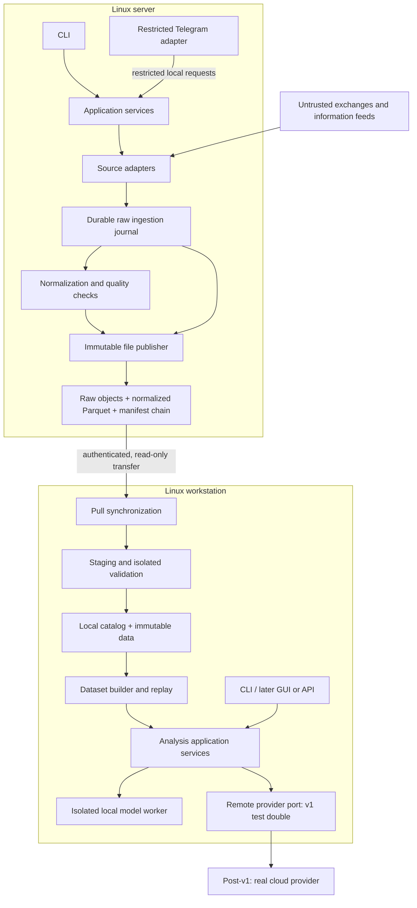

**Scryntic Foundation v1 — architecture and implementation roadmap**

Status: the overall architectural direction is approved; this focused Foundation v1 revision awaits final architecture approval. All implementation tasks below remain future work.

Scryntic is a **modular Python application with two runtime profiles: a continuous collector on the server and an analysis workspace on the workstation**. Use SQLite for durable ingestion and operational metadata, immutable analytical objects with versioned provenance, Parquet for normalized/model-ready data, and workers with verified OS isolation controls for models. Keep the physical raw archive representation behind a stable contract.

The original alternatives remain the rationale for the selected architecture; this revision does not reopen that decision:

| Approach | Strengths | Costs and limitations |
|---|---|---|
| **1. Modular application with local storage and file synchronization — recommended** | Few operational dependencies; works offline; reproducible datasets; straightforward Linux deployment. | Requires careful publication, synchronization and retention contracts. SQLite ingestion throughput must be measured. |
| **2. PostgreSQL-centered application with export synchronization** | Strong transactional querying; useful for multiple simultaneous consumers and account-oriented records. | Adds database administration; workstation synchronization still needs a separate protocol; less natural for large analytical datasets. |
| **3. Broker-centered collection with independent consumers** | Supports multiple collectors, independent processing and substantial sustained throughput. | Adds broker operation, retention coordination and distributed failure modes before those capabilities are needed. |

Choose approach 1. Reconsider PostgreSQL when concurrent operational writers become a demonstrated requirement; reconsider a broker when measured ingestion or consumer requirements exceed the single-host design.

**Repository and research basis**

Rechecked on 2026-09-14: the local checkout at `2656860c0795c76886d293b470f23dcd75482d7a` contains four tracked files: README, Apache-2.0 license, `.gitignore` and Dependabot configuration. `ARCHITECTURE.md` is an existing local, untracked planning document. GitHub's repository contents agree with the tracked inventory. There is no application implementation to preserve. The knowledge graph generation `2026-09-14T16:35:29Z` and coverage were checked, with direct document and Git inventory inspection covering this review; `.git` is intentionally excluded from graph coverage.

The useful reference patterns are:

| Reference | Observed pattern | Application to Scryntic |
|---|---|---|
| **Cryptofeed** | Typed market events, callbacks/backends, connection supervision and graceful shutdown. | Adopt these boundaries. Scryntic must explicitly define durable acceptance and overflow behavior: Cryptofeed’s inspected backend queue defaults to dropping the oldest item. [Types](https://github.com/bmoscon/cryptofeed/blob/master/cryptofeed/types.pyx), [runtime](https://github.com/bmoscon/cryptofeed/blob/master/cryptofeed/feedhandler.py), [backend queue](https://github.com/bmoscon/cryptofeed/blob/master/cryptofeed/backends/backend.py). |
| **Hummingbot** | Exchange-specific data sources feed an order-book tracker; snapshots and subsequent differences reconstruct state. Executors hold connector access. | Borrow data-source and state-reconstruction separation. Keep executor authority outside Scryntic’s initial architecture. [Connector](https://github.com/hummingbot/hummingbot/blob/master/hummingbot/connector/exchange_py_base.py), [tracker](https://github.com/hummingbot/hummingbot/blob/master/hummingbot/core/data_type/order_book_tracker.py), [executor](https://github.com/hummingbot/hummingbot/blob/master/hummingbot/strategy_v2/executors/executor_base.py). |
| **Freqtrade** | Separate worker lifecycle, CLI command dispatch, historical-data handlers, Telegram authorization and model train/predict interfaces. | Borrow explicit application entry points and lifecycle management; keep historical data and model execution independent of exchange-account operations. [Worker](https://github.com/freqtrade/freqtrade/blob/develop/freqtrade/worker.py), [commands](https://github.com/freqtrade/freqtrade/blob/develop/freqtrade/commands/arguments.py), [history](https://github.com/freqtrade/freqtrade/blob/develop/freqtrade/data/history/datahandlers/idatahandler.py), [Telegram](https://github.com/freqtrade/freqtrade/blob/develop/freqtrade/rpc/telegram.py), [models](https://github.com/freqtrade/freqtrade/blob/develop/freqtrade/freqai/freqai_interface.py). |

These were targeted architecture inspections, not exhaustive reviews of those projects. This revision rechecked Cryptofeed's backend overflow policy, Hummingbot's snapshot/difference reconstruction and Freqtrade's Telegram authorization through GitHub. The returned file blob hashes were respectively `79f9223df25b15b168320b1b558dd4b1f5731b24`, `5292380f04f91d3fba2ec377eada4f3ed16b54ed` and `a046888f10cafb5897054cc448f51d2c82115955`; the remaining references above describe the prior targeted inspection, not a new exhaustive review.

**Release scope and validation workloads**

Foundation v1 is a production-grade Linux application for continuous collection and practical analysis. An early collector or fake-model demonstration is an internal milestone, not the first completed release.

The initial deployment topology is one operator, one collector server and one workstation. Public Bybit spot data, 5–20 instruments, one-minute candles and a 90-day workstation absence are **initial validation workloads only**. They do not limit instruments, market categories, intervals, event families or retention in application contracts. Deployment configuration and measured resource budgets determine supported workloads; finite hardware still sets an operating envelope.

The first real adapter acceptance workload is historical and live finalized candles plus instrument metadata. Contracts must accommodate perpetuals, funding, open interest, liquidations, trades, order books, news and on-chain events through capabilities and typed event-family components. These additional real feeds are not all required in v1. Adding an existing event family or provider must normally require only an adapter, registration/configuration and conformance tests; adding a new family may add its schema, normalizer and coverage/replay policy without changing unrelated services. Do not implement placeholder integrations for every prospective family.

Foundation v1 includes tooling/CI, stable domain/application and source/provider contracts, configuration and secrets, real Bybit history/live recovery, raw and normalized durability, immutable publication, safe synchronization, reproducible datasets, deterministic replay, a real local model, CLI, daemon/systemd operation, health/logging, restricted Telegram status/alerts/reports, operator/extension documentation and boundary/security/recovery tests. The GUI/API application boundary is included; a GUI or public HTTP API is not.

Remote/cloud providers are supported by the provider contract and an HTTP test double demonstrating the remote boundary in v1. A real cloud integration is post-v1; v1 must have a real local integration. GUI implementation, live trading/execution, many exchanges/models, full trading simulation, HFT, clustering and distributed infrastructure remain outside Foundation v1.

**Foundation v1 Definition of Done**

> Scryntic Foundation v1 is complete when it can be deployed as a long-running Linux service, continuously collect and recover market data, safely synchronize data to a workstation, produce reproducible model-ready datasets, perform analysis through replaceable model providers, expose the core functionality through stable application services and CLI, provide operational status through Telegram, and allow new data sources and model providers to be added without restructuring unrelated core subsystems.

Release acceptance requires all Foundation tasks and the release qualification gate below. Recovery means recovery supported by the source, with unknown or irrecoverable coverage recorded; it is not a promise of lossless external feeds. Production readiness is evidenced for a declared Linux/runtime/workload profile, not every possible deployment.

**Recommended component and data flow**

SQLite is local to each host. It is never a shared network database or a file copied while live.

The codebase remains one project. Process boundaries are introduced for concrete authority or resource differences: collector, import validation, model execution and eventually Telegram. These do not require independently deployed microservices.

**Application boundaries and technology choices**

A proposed responsibility layout—not a scaffold—is:

| Boundary | Owns | Must not own |
|---|---|---|
| `domain` | Event identities, instruments, timestamps, quality states and dataset references. | Networking, storage engines, CLI frameworks or model SDKs. |
| `application` | Collect, backfill, synchronize, inspect, export, replay and analysis use cases; authorization and resource policy. | Vendor payload parsing or interface presentation. |
| `sources` | Source protocols, capabilities, transport and source-specific normalization. | Dataset selection, model execution or financial actions. |
| `storage` / `sync` | Transactions, manifests, publication, transfer and recovery. | Trusting remote metadata as local policy. |
| `datasets` / `replay` | Versioned transformations, temporal selection, deterministic replay. | Live credentials or implicit network access. |
| `providers` | Model capability contracts and local/cloud implementations. | Exchange clients or unrestricted application-service access. |
| `interfaces` / `runtime` | CLI, restricted Telegram, future GUI/API, process composition and lifecycle. | Business rules duplicated from application services. |

Dependencies point inward through narrow protocols. The composition root selects concrete adapters. A clock interface belongs at this boundary so wall time, elapsed time and time-quality evidence can be tested without altering global clocks. Domain events use a shared envelope and registered typed family schemas; they do not all require candle fields or even an instrument (for example, a news document).

Stabilize the source capabilities, envelope/schema registry, raw archive reader/writer, dataset reference/manifest, application request/result types and provider request/result contracts during v1. Version external serialization separately from Python APIs. Publish compatibility rules and conformance fixtures before release; additive capabilities are optional, unsupported required capabilities fail explicitly, and breaking changes require a new major contract version. Stable contracts do not imply freezing private implementation details or guaranteeing every future analytical algorithm will need no new component.

Recommended initial technologies:

- **Python, standard-library `asyncio`, `argparse` and `tomllib`** for runtime, CLI and TOML configuration. This keeps the initial dependency surface small. Select and lock the Python minor version during compatibility validation. [Asyncio](https://docs.python.org/3/library/asyncio-task.html), [argparse](https://docs.python.org/3/library/argparse.html), [tomllib](https://docs.python.org/3/library/tomllib.html).
- **aiohttp** for the first narrow HTTP/WebSocket adapter. Context7 verified configurable timeouts, heartbeat handling and message-size limits. Source-specific freshness checks remain necessary. [Client documentation](https://docs.aiohttp.org/en/stable/client_reference.html).
- **SQLite** for the ingestion spool, processing checkpoints and local catalogs.
- **PyArrow/Parquet** for retained observations and dataset exports.
- **DuckDB on the workstation**, as an optional analytical query engine over approved local data. Context7 confirmed its external-access and extension controls. It does not become the collector’s operational database. [Security documentation](https://duckdb.org/docs/current/operations_manual/securing_duckdb/overview).

Context7 did not return a suitable direct PyArrow documentation match, so I checked Apache Arrow’s official documentation instead. Specific model SDKs and a Telegram framework can be chosen when those tasks begin.

**Project quality and supply-chain baseline**

Use one installable project with a `src` layout and separate collector, analysis/model and development dependency groups. The collector must install and start without PyTorch, model download clients or cloud SDKs. Keep model-specific dependencies in optional groups or separately locked worker environments only where compatibility requires it; retain the same versioned worker protocol.

Select one supported CPython minor in F01 by checking the core wheels and candidate local-model compatibility. Pin its exact patch for CI/release builds, declare the supported minor range in project metadata, and record interpreter origin, uv version and artifact hashes in the release inventory. No floating `latest` interpreter or implicit system-Python dependency; upgrades are deliberate compatibility/security changes. Choosing the exact patch during implementation avoids pinning an untested runtime in this design document.

| Tool/control | Concrete purpose | Required policy |
|---|---|---|
| **uv** | Resolve and reproduce Python environments with one lock source of truth. | Commit `uv.lock`; CI and release preparation use `uv sync --locked` with explicit profile groups. `--frozen` alone does not detect stale project metadata. Pin uv itself; capture build-backend dependencies and native/GPU runtime requirements too. |
| **pytest** | Unit, adapter, integration and failure-injection fixtures. | Prefer `src` layout and importlib test imports; test the built/installed package as well as development imports. Separate offline tests from explicitly enabled real-data and target-host qualification. |
| **Ruff** | One tool for lint and formatting. | Run `ruff check` and `ruff format --check` in CI; align target Python with project policy. Avoid a second formatter/linter stack. |
| **mypy** | Verify domain, application and adapter protocol compatibility. | Strict checks on owned contracts/services; narrow documented overrides at untyped vendor boundaries, never blanket suppression. Runtime validation is still mandatory. |
| **pip-audit plus dependency review** | Detect known Python dependency vulnerabilities and inspect new authority/dependencies. | Audit each resolved deployment/worker profile and dev tooling, recording results. Review origin, licenses, native code and build hooks; fix or record a scoped, expiring risk disposition before release. An unavailable audit is not a passing audit. |
| **GitHub Actions and Dependabot** | Repeat quality checks and surface dependency updates. | Pin actions to full commit SHAs, minimize token permissions, give untrusted PR jobs no secrets, and review lock updates. No auto-merge based solely on a passing scanner. |

Context7 verified uv's Python pinning/locked synchronization, Ruff's CI checks and Python target, and mypy's structural protocols. Official documentation also supports [uv locking](https://docs.astral.sh/uv/concepts/projects/sync/), [Ruff](https://docs.astral.sh/ruff/configuration/), [mypy configuration](https://mypy.readthedocs.io/en/stable/config_file.html), [pytest integration](https://docs.pytest.org/en/stable/explanation/goodpractices.html), [pip-audit](https://github.com/pypa/pip-audit) and [GitHub Actions security](https://docs.github.com/en/actions/reference/security/secure-use). A lock reproduces dependency selection, not trust or guaranteed bit-identical native builds. Record distribution/kernel/driver and release artifacts where they affect reproducibility. Supply-chain review covers downloaded models separately from Python packages.

No Kafka, Redis, PostgreSQL, Kubernetes, general job broker, web framework or plugin marketplace is required by Foundation v1. The application owns bounded local jobs and SQLite metadata; systemd owns process supervision. Add a tool only when a task demonstrates a need the selected stack does not meet.

**Sources, normalization and event contracts**

Use a small `SourceAdapter` contract:

- Describe supported event types, instruments/entities, historical ranges, sequencing guarantees and per-family overload/recovery policies.
- Stream bounded raw envelopes.
- Fetch historical pages with an opaque resume cursor.
- Close cleanly.
- Expose health and classified failures.

Keep normalization independently callable: raw envelope plus versioned instrument metadata produces zero or more typed observations or a structured rejection. Replay uses the same normalizer without networking.

Separate optional capabilities—historical retrieval, streaming, instrument discovery—rather than requiring every news or on-chain source to imitate an exchange.

Adapters should use a reviewed, explicitly enabled registry. Adding a source of an existing event type requires an adapter and contract tests, without editing domain or application logic. A genuinely new event family requires a deliberate schema addition.

Each raw envelope records:

- Producer identity, stream identity, producer epoch and durable ingestion offset.
- Source, transport/channel, source-native identifiers and sequence numbers when available.
- Receipt wall time, boot/session identity and monotonic receipt sample, time-quality reference, payload bytes, content hash and adapter version.
- Only allowlisted transport metadata; never authentication headers or credential-bearing URLs.

Normalized observations add:

- Schema name/version and normalization version.
- Stable subject identity: instrument with venue/market category for market data, or a typed document/chain identity for other families.
- Source event time, receipt time and normalization time.
- Source publication time when available, distinguished from when Scryntic observed it.
- Raw-record references and quality/finality indicators.
- Explicit units, decimal precision and timestamp resolution.

Use exact decimals for prices and quantities; conversion to floating point belongs to a recorded dataset transformation. Missing timestamps remain missing. Names such as `BTCUSDT` are not globally unique instrument identities.

Instrument metadata distinguishes spot/perpetual/future products, base/quote/settlement assets, contract multipliers, expiry where applicable and volume units. Non-market feeds use typed document or chain identities instead. Family-specific quality and availability rules are components; the ingestion/archive/sync layers operate on bounded envelopes and versioned schemas without exchange or candle special cases.

For the first Bybit adapter, distinguish open candles from finalized candles. Bybit exposes `confirm` on WebSocket candles; its REST close price can still describe an unfinished candle, and returned candles are reverse ordered. Those differences belong in the adapter contract tests. [WebSocket candles](https://bybit-exchange.github.io/docs/v5/websocket/public/kline), [REST candles](https://bybit-exchange.github.io/docs/v5/market/kline).

**Durability, raw data and publication**

Use SQLite as a **transactional spool**, with one writer owner per state directory:

1. Apply transport-size limits and commit the raw envelope.
2. Normalize committed records.
3. Commit normalized observations or rejection records together with the processing checkpoint.
4. Seal bounded batches into immutable files.
5. Release spool rows only after their archived representation is durably published.

Configure WAL mode and `synchronous=FULL`, with bounded transactions and monitored checkpoints. An item is “durably accepted” only after its transaction commits. SQLite documents that `NORMAL` can lose committed transactions after power failure; `FULL` synchronizes the WAL on commit. [SQLite WAL documentation](https://www.sqlite.org/wal.html).

This guarantee covers committed local records, assuming functioning storage. A public WebSocket cannot guarantee recovery of every message lost before commit.

Archive raw envelopes and normalized observations separately. **Parquet is the normalized/model-ready analytical format; the raw physical format is not an architectural invariant.** A `RawArchive` contract writes bounded immutable segments and reads original envelopes by stable record/segment references, preserving byte payloads, hashes, offsets and time/provenance metadata. Descriptors include format/codec/version, encoded size and bounded decoding limits. The SQLite ingestion spool remains the initial durable acceptance mechanism regardless of archive codec.

Use a simple Parquet binary-payload implementation for the early slice. Benchmark it against a bounded compressed framed-record representation using candle and recorded/synthetic bursty trade/order-book workloads before freezing the first deployment codec. Compare sustained writes, recovery, compression, scan/random-access cost and parser surface; choose one production codec unless the evidence justifies another. This is not permission to design a bespoke database. Sync transfers opaque objects; raw readers dispatch only approved local codec implementations. Archives remain re-readable across codec changes and preserve the original raw record identity. Never import executable codecs from a remote manifest.

Publication needs an explicit state machine with one serialized publisher per producer epoch:

- Reserve a pending publication sequence and immutable input range in a local transaction; checkpoints do not advance yet. Write temporary files on the destination filesystem.
- Close, validate, hash and `fsync` the files.
- Rename to immutable object names without replacement and synchronize directories.
- After object hashes are known, persist the exact prepared manifest bytes in the pending record. Write/flush that manifest, atomically rename it into the committed manifest namespace and synchronize that directory. This manifest is the external publication commit marker, after all referenced objects are durable.
- Complete local catalog/checkpoint registration, then release eligible spool rows. Update any head pointer as a rebuildable hint, not a separate authority.

File publication and SQLite are not one atomic transaction. After a crash, reconcile the reserved record against the durable manifest: register an already published batch, or finish the exact reserved batch before allocating the next sequence. Never reuse a sequence for different bytes or prune its inputs prematurely. A crash after manifest publication but before catalog registration must recover as an already published batch; a crash before publication must not expose that batch to readers. Retain orphan objects until recovery proves them unreferenced.

Each manifest has a schema version, producer identity, epoch, strictly increasing `sequence`, `previous_manifest_hash`, object descriptors/hashes, coverage/checkpoint information and serialization/hash algorithm identifiers. Sequence 1 uses an explicit genesis value. Define one deterministic JSON serialization (restricted field types, fixed UTF-8/key ordering and integer/string representations); compute SHA-256 over the canonical body excluding `manifest_hash`, then store that hash in the wrapper. The next manifest hashes that same defined body. Reject duplicate JSON keys, unsupported algorithms and noncanonical encodings; conformance vectors fix the byte-level contract. Every object's format/version/hash/length is covered by the manifest hash.

Readers use the committed manifest namespace, never data-file listings or a potentially stale head hint alone. Restart recovery reconciles incomplete publications and orphan files. Arrow’s dataset API provides neither transactions nor ACID guarantees, so this layer is necessary. [Arrow dataset guarantees](https://arrow.apache.org/docs/python/dataset.html#a-note-on-transactions-acid-guarantees).

Organize files by source, event family and coarse date partitions, batching instruments together initially. Tune sizes from measurements; avoid one file per instrument per minute.

**Identity, revisions and schema evolution**

Distinguish three identities:

| Identity | Purpose |
|---|---|
| Ingestion identity | Tracks every received envelope and processing progress. |
| Logical event identity | Identifies the market fact, such as venue/category/instrument/interval/candle start. |
| Observation revision | Preserves changes to that fact, including corrections and later backfills. |

Repeated deliveries do not create repeated logical rows in a selected dataset. Conflicting content for the same logical identity is retained as a revision or flagged conflict, rather than silently overwritten.

Use source-native trade identifiers where reliable. Do not deduplicate all trades using only timestamp, price and quantity: distinct trades can share those values. Sources lacking reliable identity need explicitly weaker guarantees.

Schemas, normalizers and dataset recipes have separate versions. Breaking schema changes write a new dataset generation; historical files remain immutable. Unknown major versions are quarantined until a compatible reader exists. SQLite migrations require backup and explicit compatibility checks.

Late observations arrive in new files and manifests, even if their event time belongs to an old date.

**Collector runtime and failure recovery**

The daemon runs in the foreground and lets systemd supervise it.

- Bounded queues and batches; disk writes do not block the network event loop.
- Independent source supervisors with capped exponential backoff and jitter.
- Shared rate-limit budgets for live collection and backfill.
- Heartbeats plus per-stream data freshness.
- Clock synchronization quality and drift evidence on both hosts.
- Explicit states: starting, healthy, degraded, stopping and failed.
- Authentication or configuration failures require correction; transient network failures retry.
- Storage corruption or inability to commit stops ingestion rather than claiming success.

Graceful shutdown stops new intake, drains accepted work within a deadline, commits checkpoints and closes resources. Forced termination relies on journal recovery.

Track **coverage**, not just “latest timestamp.” Coverage distinguishes complete, pending backfill, unknown and unrecoverable intervals. A reconnected socket does not prove continuity.

For candles, detect expected interval gaps and backfill with overlap. For future order books, invalidate state on sequence failure and require an appropriate snapshot before accepting subsequent differences. Some lost streams cannot be reconstructed; preserve that fact.

**Per-family backpressure and coverage**

Bound queues by bytes and count, including in-flight/decompressed payloads. First pause producers where the protocol permits, reduce scheduled fetch work and prioritize draining committed data. If sustained intake exceeds capacity, close/resubscribe affected live streams with an explicit coverage transition; blocking a local queue does not make a remote WebSocket lossless. Never evict durably accepted data to hide pressure. Quarantine and diagnostic storage also have quotas.

| Event family | On overload, disconnect or missing sequence | Recovery and dataset consequence |
|---|---|---|
| Candles | Mark the affected interval pending/unknown; no silent eviction of final candles. | Backfill overlapping ranges where supported. Finality and revision rules apply; open snapshots remain distinct from completed observations. |
| Trades and liquidations | Preserve received event identity; record a sequence or observed-time coverage gap. | Backfill only with documented source history. Where completeness cannot be established, keep unknown/irrecoverable coverage; never infer no trades from no messages. |
| Order-book snapshots/deltas | Invalidate the affected book immediately on loss or broken continuity; stop publishing valid-book projections. | Resnapshot and apply only a proven contiguous difference sequence. The missing interval remains unavailable for faithful replay even after current state is restored. |
| Funding, open interest and periodic observations | Pause polling or record missed samples/updates. | Use family-specific historical endpoints when available; a current snapshot cannot recreate historical samples. Snapshot coalescing, if enabled, is an explicit lossy derived view, not a complete raw archive. |
| News and on-chain events | Retain source cursor/identity; mark uncertain coverage, including reorgs/retractions. | Resume with overlap and revisions. Chain confirmation/reorg policy belongs to the family; publish corrections without rewriting history. |

Only implemented families get real adapters in v1, but the policy contract and synthetic non-candle conformance tests are release requirements. Loss records carry source/stream, affected identities or best-known interval, reason, detection time quality and recovery status; they do not invent exact missing counts. Reserve disk/metadata headroom for coverage transitions. If storage fails before a transition can be persisted, mark the period since the last verified checkpoint as unknown on restart and retain external logs as supporting evidence.

**Clock integrity and timestamp trust**

Use UTC wall time for cross-system timestamps and provenance; retain the original source timestamp/resolution. Use monotonic elapsed time for retry deadlines, rate-limit scheduling, heartbeat age, queue latency and shutdown timeouts. Monotonic samples are scoped to a boot/session and never compared across hosts or restarts; after suspend/resume, invalidate stale connections and refresh clock quality before relying on freshness. Persist source cursors and logical offsets for recovery instead of reusing monotonic deadlines. Python documents monotonic clocks separately from adjustable wall time. [Python time documentation](https://docs.python.org/3/library/time.html).

The operator supplies host time synchronization. Scryntic reads synchronization status, estimated offset/uncertainty and age of that evidence through an unprivileged clock-status adapter (for the deployed chrony/systemd time service). A bare synchronized flag is insufficient to claim a drift bound. Compare wall-time deltas with monotonic deltas to detect steps; exchange timestamps are an additional plausibility signal, not the authority for host time. Scryntic never sets host time or gains time-administration privileges.

Configuration declares drift/uncertainty limits and maximum evidence age appropriate to each workload. Missing, stale or out-of-budget evidence changes clock health to `unknown`/`degraded`, emits status/alerts and tags observations with a time-quality epoch. Public collection continues with offsets and original timestamps to preserve evidence, but wall-time-derived finality, trusted latency metrics and strict as-observed dataset/replay decisions fail closed or exclude affected records. Do not bypass TLS verification to work around bad time. Explicit historical-reconstruction analysis can include flagged data with a recorded policy; it cannot claim trustworthy observation timing.

Acceptable clock quality does not mean zero uncertainty. Preserve the estimated time interval for each relevant observation/decision, including evidence age. Strict as-observed selection requires the **latest plausible observation time** to be no later than the cutoff (or the earliest plausible decision time when the cutoff itself is uncertain). Wall-clock-derived finality requires the **earliest plausible current time** to be past the closing boundary under the documented source finality policy; defer observations whose uncertainty overlaps that boundary. Do not substitute a healthy-clock flag for these comparisons. These estimates depend on the declared host/source trust assumptions and do not prove physical time against a compromised source.

On recovery, begin a new time-quality epoch and reconcile ambiguous finality/coverage using source evidence. Never silently rewrite previously captured receipt times. Imports retain the server's time-quality claims and add the workstation's own quality/import time; neither a manifest hash nor an authenticated timestamp proves that the remote clock was correct.

Disk retention is a capacity obligation. Initial archival deletion should be explicit, with a dry-run preview; do not automatically delete old files merely because the workstation is absent. At a configured high-water mark, stop lower-priority backfill and alert; before exhaustion, stop intake safely and record coverage loss. Finite storage cannot promise unlimited offline retention.

**Server → workstation synchronization**

Start with **workstation-initiated pull over OpenSSH/SFTP**, using a pinned host key and a dedicated account that can read only published artifacts. The server receives no workstation login credential. Avoid agent forwarding and general remote command execution.

Synchronize application artifacts, not live SQLite files:

1. Read a bounded manifest sequence.
2. Request missing immutable objects by validated identifiers.
3. Download to a staging directory with byte and disk quotas.
4. Verify hashes, lengths, supported schemas and manifest relationships.
5. Parse with memory/time limits in a process without credentials or network access.
6. Validate data types, timestamps, instrument references, ordering and provenance references.
7. Atomically register accepted objects and update local synchronization progress.

Catalog acceptance establishes conformance to checks, not permanent parsing trust. An exploited validator could approve an object that attacks a later decoder. Native decoding of imported raw/Parquet objects and worker-produced analytical files remains inside restricted workers for inspection, dataset creation/export, replay and model preparation too. The application receives size-bounded primitive metadata/results and validates them independently; it never accepts Python objects, executable serialization or remote extension types over that boundary. Arrow batches may be exchanged within the restricted analytical/worker context, but must not become a route to native decoding in a credential-bearing coordinator. Hashes bind artifacts; they do not make decoder code safe or prove a worker's numerical result correct.

Interrupted downloads can resume or restart per object. Repeated synchronization is idempotent. A failed object cannot be skipped while claiming complete synchronization.

Progress follows publication sequence, not event time, so late corrections are discovered. Persist the accepted `(producer, epoch, sequence, manifest_hash)` anchor locally in the same transaction that registers validated data. Require the next sequence and matching predecessor hash. A conflicting hash at an accepted sequence, truncated advertised history, missing predecessor or unexpected epoch is an integrity incident, not automatic resynchronization. A stale head hint triggers direct chain discovery/retry and a degraded freshness report; it never resets local progress.

First enrollment explicitly records the trusted server identity and genesis/checkpoint anchor through the local operator workflow. A new workstation has no prior history to compare; trust on first enrollment is not proof of a clean history. Preserve anchors/manifests in workstation backups independently of server retention. A restored collector either continues the exact committed chain or starts an operator-approved new epoch; never silently reset sequences. Keep small manifest history after raw-object retention; manifests can legitimately refer to explicitly expired objects, which prevents complete reconstruction of those datasets. Bootstrap from a checkpoint after retention requires explicit acceptance of that coverage boundary. The initial read-only SFTP account cannot authorize pruning or update trust anchors.

Record local import time separately from server receipt time. Server timestamps remain claims supplied by another host.

Hashes, chained manifests and authenticated transport detect corruption and changes inconsistent with retained local history. **They do not establish market truth after server compromise.** A compromised producer can append plausible false data, withhold future data or present alternate histories to newly enrolled clients. Freshness checks can flag staleness but cannot prove how much unpublished data exists. Server-held signing keys would not remove this limitation, so a signing/key-management service is not required in v1. Previously retained anchors expose inconsistent rewrites; independent source comparison and selective re-normalization provide additional evidence.

Synchronization also is not backup. Until copied elsewhere, server-only data remains vulnerable to disk loss or server compromise.

**Datasets, analysis and replay**

The primary model-ready export is **Parquet plus a JSON manifest**.

- Parquet: typed time series, features, labels and provenance columns.
- Arrow record batches: bounded in-process exchange with analytical/model adapters inside the restricted analytical/worker context.
- JSONL: later, only where a text-corpus or provider integration specifically benefits from it.

Do not maintain equivalent copies in every format.

A dataset manifest records exact input object and publication-manifest hashes, schemas, raw format versions, transformation versions, selection rules, ordering, time range, time-quality/coverage exclusions, feature/label definitions, splits, code revision and dependency-lock digest. Model runs additionally record provider/model revision, origin, approved usage-policy identifier, parameters, seed, hardware and determinism limitations. Explicit dataset pins prevent deletion of required objects unless the operator deliberately retires the dataset; retained metadata alone cannot reproduce deleted source data.

Datasets are immutable snapshots. Rebuilding a recipe should reproduce the same selected records and values under a pinned environment; byte-identical files require a separately specified writer configuration.

Prevent time leakage explicitly:

- Preserve when information became observable.
- Do not treat today’s historical backfill as information available to a past live decision.
- Offer separate “historical reconstruction” and “as observed” replay modes; strict cross-host timing claims require acceptable time-quality evidence. Ingestion offsets provide local order, not a trusted global chronology.
- Fit transformations on training partitions only.
- Make gaps and imputation visible.
- Use temporal splits, with purging where overlapping labels require it.

Foundation v1 includes deterministic candle replay, temporal splits, a simple statistical baseline and forecast evaluation against a real local model. The replay clock and reader contract allow family-specific readers later. Full strategy backtesting is post-v1 and adds a simulated ledger with explicit fees, slippage and fill assumptions. Candle data cannot justify detailed intrabar execution claims. Do not execute model-generated SQL; analytical queries are application-owned and use approved dataset files, bounded resources and disabled extension auto-installation. DuckDB settings are defense in depth, not a substitute for OS controls around hostile files.

**Model-provider interface**

Avoid a universal `predict(anything)` interface. Use a shared provider descriptor with task-specific capabilities:

| Contract | Input | Output |
|---|---|---|
| Forecast | Dataset reference, target, frequency, horizon and optional covariates. | Timestamped forecasts, optional quantiles and diagnostics. |
| Text analysis | Bounded documents and a declared task/output schema. | Validated structured analysis and source references. |
| Optional training | Dataset/split references and approved parameters. | Versioned artifact reference and training report. |

Providers declare supported capabilities, size limits, resource requirements and whether data leaves the host. Unsupported requests fail explicitly. PyTorch tensors and vendor response objects do not cross into core services. The same versioned job contract supports local and remote implementations; a remote HTTP test double in v1 proves serialization, timeouts, cancellation behavior and output validation without contacting a paid provider.

The provider/model descriptor also contains immutable model revision and artifact hashes, origin repository/provider, publisher, license identifier or license-text digest, model-card/terms references, approved allowed-use/deployment policy, and review date. Record loading requirements: runtime/library versions, custom code, pickle or native serialization, network/download needs, CPU/GPU/driver requirements and memory bounds. Package, code and weight licenses may differ. A deployment policy must explicitly accept the intended use; unknown or incompatible terms, mutable/unverified artifacts or unapproved loading requirements block model admission. Technical compatibility alone does not satisfy admission. A later remote provider must additionally identify its service/model version and applicable data-use/retention terms; unpinnable versions are recorded as a reproducibility limitation.

Application services own bounded local jobs, cancellation, deadlines, output validation and artifact registration. SQLite records job identity, input manifest, provider/policy identity and state. Requests are idempotent; results become visible only after validation and durable artifact registration. After a crash, unfinished jobs become interrupted and are explicitly resumed/retried where safe, rather than remaining falsely running or spawning duplicate attempts. No job broker is needed.

**Model-worker threat model and isolation acceptance**

Assume a downloaded artifact, approved provider code with a compromised dependency, or native parser can execute arbitrary code inside its worker and attempt file access, network access, excessive allocation or malicious output. The trusted computing base includes the operator-owned launcher, Linux kernel, selected isolation configuration and any enabled GPU driver/runtime. A malicious host administrator or kernel/driver compromise is outside the protection claim. Do not describe workers as absolutely sandboxed.

The supported production profile launches workers under a separate unprivileged identity with a private mount namespace, read-only explicitly selected datasets/model artifacts, an empty/private home and temporary area, and a single job-output mount. Hide credential/configuration/SSH directories and host control sockets; sanitize environment, inherited descriptors and supplementary groups. Use `NoNewPrivileges`, an empty capability set, disabled core dumps, restricted process visibility, no network namespace connectivity by default, and cgroup/process/output-size/time limits. Prevent links or races in worker-created outputs from escaping the assigned artifact directory; import results as untrusted data. Operator-controlled, fixed launch specifications enforce these controls; no user/model-supplied shell or unit fragments and no general privileged launcher API.

The CLI submits the same fixed job contract to this launcher; it does not load untrusted models in-process. Missing required isolation controls cause launch failure. The CPU profile is the qualification baseline. A GPU profile exposes only required devices and records tested driver/runtime versions and extra system-call/device permissions; shared GPU memory/resource behavior and kernel driver attack surface remain residual risks. GPU support is optional until that profile passes its tests; a real CPU-capable local provider can satisfy v1. Separate environments or a subprocess under an unrestricted shared Unix identity do not establish a security boundary.

Qualification probes attempt reads of denied files, network/host-socket access, writes to input mounts, symlink output escape, process spawning, inherited-secret discovery and resource exhaustion. Record actual namespaces, effective permissions, resource controls and probe results on the supported host. These tests verify specified controls, not immunity to kernel exploits or every native-library/GPU vulnerability. The input-validation worker uses the same control principles with no model/device access. Where the platform cannot enforce the selected profile, refuse that workload rather than silently run with weaker privileges.

Cloud adapters possess only their own provider credential and accept policy-approved data. Require explicit cloud enablement, outbound-field policy, request/cost limits and recorded provider versions. Do not silently fall back from local to cloud.

Downloaded models are executable supply-chain inputs. Pin revisions, prefer data-only weight formats where supported and disable remote code by default. PyTorch’s restricted loading still has documented resource and memory-safety limits; model isolation remains necessary. [PyTorch serialization](https://docs.pytorch.org/docs/main/notes/serialization.html), [Hugging Face custom model loading](https://huggingface.co/docs/transformers/en/custom_models).

**Codex Security design review**

This revised threat map applies Codex Security's threat-model guidance to the proposed architecture, the supplied security requirements and the inspected repository state. A separate read-only architecture review identified the need to retain restricted decoding after catalog acceptance and to apply clock uncertainty conservatively at cutoffs; those requirements are incorporated here. There is no application code to establish implemented controls: the rows specify enforcement owners and acceptance requirements, not validated vulnerability findings or sandbox guarantees.

| Trust boundary | Principal risk | Required control and residual limitation |
|---|---|---|
| External feed → collector | Malformed input, parser exhaustion, misleading market data. | Bounded transport and parsing, strict normalization, quarantine and quality checks. Valid-looking false data remains possible. |
| Collector → exchange account | Collector compromise exposes financial authority. | Foundation v1 uses public endpoints without keys. Any later authenticated collector uses exchange-enforced read-only credentials with no trading, transfer or withdrawal authority. A code-level read-only wrapper is insufficient. |
| Server → workstation | Rewritten publication history, malicious manifests, path traversal, parser exploitation or poisoned history. | Sync owns local chain anchors and validation; OS launch controls restrict parser authority. Generated paths, no symlinks/archive extraction, quotas and semantic validation. A compromised producer can still append plausible false records or withhold data. |
| Model → host/application | Malicious weights/code, output injection, resource exhaustion. | Launcher owns tested identity/namespace/resource controls; application owns admission and result validation. No model tools or financial capability. Kernel/native/GPU risks remain as specified in the worker threat model. |
| Application → cloud provider | Disclosure of private data or uncontrolled spending. | Explicit enablement, data minimization, provider-specific credentials, destination and budget limits. Provider retention behavior remains external. |
| Telegram → application | Unauthorized commands, replay and output injection. | Allowlist numeric user **and** chat IDs, fixed commands, deduplication, rate limits and escaped output. No secrets, raw queries or arbitrary paths. |
| Secrets → state/logs/export | Accidental leakage or ambient access. | Separate credential storage, narrowly scoped loading, structured allowlisted logs and redaction tests. The credential-owning process necessarily has access while running. |
| Extensions → host | Installed adapter code inherits process authority. | Explicitly enabled, pinned, reviewed packages; no automatic installation or arbitrary imports from configuration. Isolate extensions requiring different privileges. |
| Host/source clocks → time-sensitive decisions | Drift, forged source timestamps or wall-clock steps create false finality, latency or hindsight-free results. | Clock-status adapter reports evidence without time-setting authority; application/data policies degrade or reject unsupported timing claims. Remote time remains a claim even in a valid hash chain. |
| Dependency/model origin → deployment | A locked package/model carries malicious code or unacceptable use/loading terms. | Operator-owned admission inventory and CI review cover origins, hashes, licenses, native code and requested privileges. Locks and advisory scanners do not prove benign content. |
| Worker/Telegram → local service socket | A narrow interface accidentally exposes full operator authority. | Separate socket permissions and peer-identity checks; dispatcher allowlists request types per peer. No arbitrary paths, queries, launch parameters, secret resolution or configuration changes. |

For later private exchange access, use a dedicated credential-owning connector process. Do not hand the entire application configuration or secret resolver to source-independent code.

If trading is ever approved, create a separate execution plane with its own credentials, deterministic risk checks, authorization, reconciliation and kill switch. Model output would be a proposal requiring validation, never an executable instruction. No execution-plane implementation is needed now.

**CLI, Telegram and Linux operation**

The CLI should expose application use cases such as:

`collect`, `backfill`, `status`, `sources`, `sync`, `data inspect`, `dataset build`, `replay`, `analyze`, and `config validate`.

Support stable exit codes, cancellation and machine-readable JSON output. Identical use cases should be testable without invoking the CLI.

Configuration has explicit precedence: built-in defaults, one selected TOML file, then documented non-secret CLI overrides. Unknown keys and incompatible profile combinations fail before network/worker startup. Secret values are not CLI arguments or ordinary configuration fields: resolve named references only inside the owning adapter from protected credential files/systemd credentials. Enforce ownership/mode expectations and scoped permissions; never include values in effective-config output, exceptions or manifests. The public collector needs no exchange secret; the Telegram adapter owns only its bot token. The workstation transfer client owns its SSH credential, never passes it to parser/model workers, and does not inherit a general SSH agent by default. No generic secret-resolver service is exposed to models or Telegram.

Foundation v1 Telegram provides collector health/status, bounded alerts and collection/coverage reports through a restricted local socket. Default deployment places one polling adapter on the server so it works while the workstation is offline. Workstation analysis reports are available locally via CLI; automatic forwarding of those reports is a later explicit data-transfer feature, not a new reverse synchronization channel in v1. Authenticate Unix peers and permit only fixed read/status/report methods for the bot identity, with no collector-database write access. Run it separately with its own token. Long polling avoids a public webhook endpoint. Telegram retains incoming updates for at most 24 hours, so it cannot act as Scryntic’s durable queue. [Telegram Bot API](https://core.telegram.org/bots/api#getting-updates).

Deduplicate incoming update IDs; keep bounded bot delivery/retry state separate from collector state, expire stale alerts and report delivery degradation without interrupting ingestion. Outbound delivery can duplicate around network failures, so include stable alert IDs and avoid claiming exactly-once delivery. Escape feed/model-supplied text and allow only explicitly approved report fields; no raw private payloads or automatic URL fetching.

A future GUI/API calls the same versioned request/result services, adding authentication and transport concerns without moving business rules into handlers. The v1 local socket is a narrow operational facade, not a public API framework. No web server is needed in Foundation v1.

Foundation v1 provides unit examples and a runbook for the operator's later manual Linux installation, covering:

- Dedicated service identity; operator-owned executable and configuration.
- State under `/var/lib/scryntic`, runtime files under `/run/scryntic`, configuration under `/etc/scryntic`.
- Secret references in TOML; credentials supplied through protected files or systemd credentials.
- Restart policy, stop timeout and startup recovery.
- `NoNewPrivileges`, filesystem restrictions, private temporary storage and explicit writable paths.
- Separate limits and device access for model workers.
- Backup, restore, upgrade and rollback procedures.

The exact hardening directives must be verified on the target distribution. [systemd execution settings](https://manpages.debian.org/trixie/systemd/systemd.exec.5.en.html).

Logs go to stderr/journald with structured fields and no payload dumps by default. Status reports include last received/committed/published offsets, stream freshness, queue usage, disk reserve, normalization failures, gaps, clock evidence/quality, job state and shutdown state. An alive process with stale feeds or unreliable time is degraded, not healthy. Readiness reports storage recovery/configuration/required-control completion separately from liveness and source freshness. No network health listener is required; CLI and restricted local status access are sufficient. Configuration changes use validated restart in v1; arbitrary hot reload is deferred.

**Ordered implementation backlog**

All tasks are future implementation work after final architecture approval. Foundation v1 comprises **F01–F30**; post-v1 tasks are explicitly separate. Phase labels group responsibility, while the dependency column defines execution order. No task requires completion of a later-numbered task. Each task owns its named component/contract, adds focused tests and documentation, and ends with a reviewable deliverable. F09 is the first end-to-end milestone, not a releasable product. Security and durability checks grow with each task rather than waiting for the operational phase.

**Architectural/tooling foundation**

| Task and goal | Main scope / resulting contract | Dependencies | Security considerations | Completion criteria |
|---|---|---|---|---|
| **F01. Establish reproducible project/runtime baseline** | One installable Python project, profile dependency groups, supported Python policy, exact interpreter/uv pins and dependency/build lock inventory. | Final architecture approval | Check package origin and wheel/model compatibility; no runtime self-installation. | A clean Linux environment can build/install the same locked collector and workstation profiles; stale lock metadata fails; collector imports/startup need no model dependencies. Record supported OS/Python and artifact hashes. |
| **F02. Establish quality and supply-chain gates** | GitHub Actions, pytest, Ruff, mypy, dependency audit/review and packaging checks; document local equivalents. | F01 | Pin actions and limit token permissions; no secrets or privileged runners for untrusted PR code. | Test/lint/format/type failures and stale locks fail CI; each resolved profile has an audit result or explicit expiring disposition. A built-wheel test detects missing package resources. No auto-fix or auto-merge hides failures. |
| **F03. Define domain/application and extension contracts** | Bounded envelope, typed candle/instrument schema, source capabilities, clock interface, raw archive port, dataset references, application DTOs and minimal provider descriptor/request/result; fake source/clock/provider. | F01, F02 | No exchange/financial authority, secret resolver or arbitrary code-loading API in contracts. | Type and import-boundary tests reject vendor/CLI dependencies in core; fixtures verify decimals, category/entity identity, schema versions and unsupported capabilities. Document who owns each contract and compatibility policy. |
| **F04. Implement configuration and credential boundaries** | TOML/profile validation, explicit precedence, path ownership, scoped secret references and safe diagnostic configuration. | F03 | No secrets in arguments, ordinary state or logs; fail on missing/unsafe credentials only for enabled capabilities. | Invalid keys/profiles fail before networking; sentinel secret tests cover output/errors; public collection config resolves no exchange credential. Protected-path and permission failures are explicit. |

**Early end-to-end vertical slice**

The slice is exactly: **fake source → durable ingestion → normalization → archive → dataset → fake model provider**. Use real local SQLite and immutable files, not in-memory substitutes for the durability/publication boundaries. Keep the workload small and omit live networking, systemd and production isolation until their designated tasks; only trusted fake providers run in-process here.

| Task and goal | Main scope / resulting contract | Dependencies | Security considerations | Completion criteria |
|---|---|---|---|---|
| **F05. Make ingestion durable** | Single-owner SQLite writer, raw spool, ingestion offsets, bounded intake, WAL/FULL settings and startup recovery. | F03, F04 | Payload limits; no silent eviction; reject competing writers. | Abrupt process termination preserves every acknowledged committed envelope; failed commits never advance acceptance; repeated fake deliveries retain distinct ingestion identities. |
| **F06. Normalize with recoverable progress** | Pure candle normalization, raw references, logical identity/revision handling, rejection records and transactional processing checkpoint. | F05 | Bound parsing and quarantine; retain evidence without executing it. | Fake-source malformed/finality/duplicate/conflict fixtures produce expected observations; reprocessing yields the same values; kill/restart cannot put progress ahead of results. |
| **F07. Publish the first immutable archive** | Simple raw Parquet codec behind RawArchive, normalized Parquet, pending/publication state machine and versioned manifest chain. | F06 | Hash all objects; canonical manifests, generated paths and no replacement of committed identities. | Raw bytes round-trip; hash-chain vectors match; interrupted publication never exposes partial referenced objects and can resume without changing a prepared manifest. No spool pruning before durable publication. |
| **F08. Build the first dataset snapshot** | Application-owned selection over exact manifests, deterministic ordering, Parquet export and JSON dataset manifest. | F07 | No arbitrary SQL, remote paths or implicit code loading. | Fixed fake input reproduces identical logical records and complete raw/normalized provenance; missing objects and unsupported schemas fail explicitly. |
| **F09. Complete the source-to-model slice** | Minimal CLI/application composition, fake forecasting provider invocation and validated result artifact referring to the dataset. | F08 | Trusted test provider only; bounded validated output; no real model loading or network. | One integration test drives the full stated path through disk; rerun/restart produces the same selected data and fake forecasts. Swapping a second fake provider changes no ingestion/dataset/core services. |

**Data foundation**

| Task and goal | Main scope / resulting contract | Dependencies | Security considerations | Completion criteria |
|---|---|---|---|---|
| **F10. Measure operating envelope and select raw codec** | Public/recorded candle workloads plus synthetic/recorded trade/book bursts; raw codec comparison, queue/segment/retention budgets and performance report. | F09 | Public inputs only, bounded acquisition; codecs are locally approved code. | Compare the simple codec with one framed/compressed alternative on throughput, size, memory and interrupted reads. Choose one supported codec and record tested workload limits/headroom, including a 90-day sizing calculation that is configuration rather than a product cap. |
| **F11. Harden publication and chain recovery** | Full publication fault matrix, pending-record reconciliation, canonical hash validation, epoch/sequence collision handling and selected raw codec compatibility. | F07, F10 | Refuse conflicting history; retain uncertain orphans/inputs; no remote-selected executable codec. | Fault injection before/after file fsync, rename, manifest commit and catalog update converges correctly; competing publication fails; known hash/sequence/encoding conflicts fail; a prior-codec fixture remains readable. |
| **F12. Implement clock-quality monitoring** | Unprivileged host synchronization-status adapter, wall/monotonic comparison, time-quality epochs and degraded health policy. | F04, F06, F09 | No clock-setting privilege; source time is a separate trust claim. | Fake-clock tests cover steps, stale/absent evidence, excess uncertainty, suspend/restart and within-budget uncertainty straddling a finality boundary. Time-sensitive operations defer/reject ambiguous claims while safe capture continues; verify offset/status evidence on the supported host. |
| **F13. Add Bybit historical retrieval** | Instrument metadata and category-aware capabilities, paginated finalized candles, historical cursor persistence and time-quality-aware finality. | F06, F10, F12 | Public endpoint allowlist, TLS and response/rate limits; no account keys. | Recorded fixtures cover reverse ordering, overlap, unfinished candles, unit/category differences and restart continuation; a bounded public-data test confirms the documented endpoint behavior. |
| **F14. Add Bybit live collection** | WebSocket transport, subscription/finality, heartbeat and bounded intake through the same journal/normalizer. | F05, F12, F13 | TLS validation, message/decompression limits; safe error metadata. | Local server simulations cover stalls, malformed frames, duplicates and reconnect; bounded real-data capture reaches archive/dataset without alternate live-only schemas. |
| **F15. Add recovery and per-family pressure policy** | Coverage ledger, source supervisors, shared live/backfill budget, candle overlap repair and family-specific loss-policy dispatch. | F11, F13, F14 | No silent overflow; bound repairs/quarantine and reserve metadata headroom. | Disconnect/overflow tests repair recoverable candles; synthetic trade gaps stay visible and book gaps invalidate/resnapshot. Unsupported completeness remains unknown; inability to persist a loss marker creates conservative unknown coverage on restart. |
| **F16. Validate hostile imports under restricted authority** | Staging, approved format/schema checks, restricted decoder/result protocol and transactional local import catalog. | F04, F11, F12 | Enforce no network/secrets/device access and resource/path limits; catalog acceptance never grants parsing trust. | Corruption, duplicate keys, unsupported codecs, traversal, symlink/race, oversized decode and timeout fixtures cannot advance the catalog or escape storage. Validate bounded worker messages independently; probes verify restrictions and unavailable controls fail closed. |
| **F17. Implement resumable authenticated pull** | Read-only SFTP, enrollment/anchor storage, chain discovery, missing objects, interrupted downloads and epoch reconciliation. | F11, F16 | Pin host identity; isolate transfer credential; no forwarding, remote shell or pruning authority. | Repeated/interrupted pulls converge; later corrections arrive; rewritten/truncated history, wrong predecessor and unexpected epoch fail without resetting anchors. Test stale head hints, explicit bootstrap and backup/restoration of accepted anchors. |
| **F18. Complete dataset/provenance and schema evolution** | Revision selection, coverage/time-quality policy, feature/label recipes, schema compatibility, dataset pins and restricted analytical inspection/export. | F08, F12, F15, F17 | Native decoding stays restricted after acceptance; trusted transforms only, no implicit imputation/network reads or executable deserialization. | Imported inputs reproduce logical values/provenance. Cutoff fixtures exclude later knowledge and overlapping uncertainty even within drift budget. Decoder-boundary tests prevent coordinator parsing; unknown major versions fail and old supported schema/dataset references remain valid. |

**Intelligence/model foundation**

| Task and goal | Main scope / resulting contract | Dependencies | Security considerations | Completion criteria |
|---|---|---|---|---|
| **F19. Add deterministic replay and baseline evaluation** | Replay clock/readers, availability cutoffs, temporal splits, train-only transforms and simple statistical forecast baseline. | F18 | Offline application-owned computation; no live connector imports. | Replay with fixed inputs/configuration reproduces results; future-data and overlapping-label fixtures expose leakage; gaps/time-quality exclusions appear in the evaluation report. |
| **F20. Complete provider admission and durable jobs** | Versioned local/remote job contracts, metadata/license/loading-policy checks, persisted job states, cancellation/deadlines and remote HTTP test double. | F09, F18, F19 | Policy-approved input/outputs; remote disabled by default; unknown use/loading policy blocks admission. | Missing origin/revision/license approval and unsafe loader requirements are rejected. Fake local/remote implementations pass the same contract tests; interrupted jobs recover without duplicate success; malformed/oversized responses never become accepted results. |
| **F21. Qualify model-worker isolation** | Fixed launcher and per-job identity/mount/network/resource restrictions; CPU profile, optional separately qualified GPU profile and safe result import. | F16, F20 | No generic elevated launcher or user-supplied unit/shell configuration; explicit kernel/driver trust assumptions. | Record effective controls and probes for denied files, host sockets/network, immutable input, output-link races, inherited secrets and process/memory exhaustion. Missing controls reject launch. GPU profile records device/driver exceptions and test evidence; no claim of absolute containment. |
| **F22. Integrate and evaluate one real local model** | Select a CPU-capable model/provider or qualify its required GPU profile; pin artifacts/environment and implement preprocessing/output conversion. | F19, F20, F21 | Approve origin, license/allowed use and loading requirements; download/provision outside inference worker; verify hashes before launch. | Approved model runs offline on a real Bybit-derived dataset, generates validated forecast/evaluation artifacts and compares against F19's baseline. Record limitations and resource use; no promised forecasting advantage is required. Switching back to fake/another conforming provider changes no unrelated services. |

**Operational foundation**

| Task and goal | Main scope / resulting contract | Dependencies | Security considerations | Completion criteria |
|---|---|---|---|---|
| **F23. Complete daemon lifecycle and observability** | Foreground service composition, signals, readiness/liveness/degraded states, structured logs and bounded health snapshots across data/job subsystems. | F12, F15, F17, F20 | Sanitized errors, no payload dumps; source/worker failures do not grant fallback privileges. | Graceful/forced stops recover at each checkpoint; stale feed, unreliable clock, storage pressure and failed jobs are accurately visible. Normalizer/storage failure policies are tested; logs pass sentinel-secret checks. |
| **F24. Complete CLI/application use cases** | CLI for config validation, sources, collect/backfill, status, sync, data/dataset inspection/build/export, replay and analyze/jobs. | F18, F19, F22, F23 | Fixed typed requests and path policy; no in-process real model loading or arbitrary command forwarding. | Installed CLI exercises all main use cases with stable JSON/exit codes and cancellation; application-service tests exercise the same rules without a CLI dependency. |
| **F25. Expose restricted operational reports** | Unix socket/read facade for health, alerts and bounded collection/coverage reports; peer authorization and bot-specific method set. | F18, F23 | Bot identity cannot mutate collector config/state, launch jobs, resolve secrets or supply arbitrary paths/SQL. | Allowed peers receive only approved fields; unauthorized peers/methods fail, oversized requests are bounded and report generation cannot starve collection. |
| **F26. Add Telegram status, alerts and reports** | One server-side polling adapter, user/chat checks, update deduplication, escaped presentation, bounded delivery state and retry/expiry. | F04, F25 | Bot token stays in adapter; no raw payload/config export; no reverse workstation synchronization. | Test unauthorized/replayed commands, rendering injection, timeouts and stale alerts; a manual real bot test demonstrates status/report/alert delivery. Bot/API failure leaves collector running and reports delivery degradation. |
| **F27. Provide systemd-ready deployment profiles** | Operator-controlled collector, transfer-access, parser/model launcher and Telegram configuration/unit examples; safe restart, credentials and time-service prerequisites. | F16, F21, F23, F26 | Dedicated identities, fixed launch policies, restricted SFTP paths, least privilege and profile-specific device rules. | Operator can manually install on a clean supported Linux host using the runbook; effective permissions/controls pass probes and reboot resumes collection. No automatic server installation or generic privilege escalation helper. |
| **F28. Prove extension compatibility and document use** | Operator CLI/dataset/model guide, source/provider author guide, versioning policy and reusable conformance fixtures. | F18, F20, F22, F24, F26, F27 | Document authority required by adapters and model-admission rules; forbid ambient credentials and dynamic downloaded plugins. | A separately registered test source and typed non-candle family pass ingestion/archive/sync conformance without edits to unrelated services; a second provider passes job/replay contracts. Documentation shows precise extension points, unsupported-capability behavior and troubleshooting. |
| **F29. Qualify retention, upgrade and disaster recovery** | Operator-only maintenance CLI for disk-watermark/pruning previews, dataset pins, manifest retention, SQLite migration backup and manual restore/rollback procedures. | F11, F15, F17, F18, F24, F27 | Deletion requires explicit operator action; preserve local trust anchors and refuse rollback-induced chain reuse. | Disk-pressure tests stop safely; pruning protects pinned data and does not reset history. Restore from an independent backup reproduces a dataset/anchor; a test schema migration and failed-upgrade rollback preserve data or require an explicit new epoch. |
| **F30. Qualify Foundation v1 release** | Cross-profile acceptance, real-data soak, release inventory, security/boundary review and completed operator/extension documentation. | F01–F29 | Review effective trust boundaries and residual risks on the release profiles; no account/execution authority. | Pass the release gate below and record evidence for each criterion. Any required feature or critical invariant without evidence prevents the Foundation v1 completion claim. |

**Release qualification gate**

A release candidate must pass these checks on its declared supported Linux, filesystem, interpreter, dependency and model profile:

- Clean locked build/install, installed-package tests, lint/format/type checks, dependency/model admission review and versioned artifact inventory. No unresolved violation of the architectural security/durability invariants; other risks have scoped owner-reviewed dispositions.
- At least 72 hours of continuous public-data collection within the F10 declared workload envelope, with injected network disconnects and graceful/forced process restarts. Account for every locally committed input as archived, pending or explicitly rejected; bound queue/memory/disk growth and expose all observed/unknown gaps. Longer or higher-volume workloads need additional qualification, not a claim of universal scale.
- Simulate the configured offline horizon and retention volume with fixtures, then reconnect a separate workstation profile. Verify repeated/interrupted pull, corrupt objects, history conflicts and local-anchor recovery; a 72-hour run alone does not demonstrate 90-day retention.
- Rebuild the same logical dataset from retained inputs; verify temporal/clock-quality selection, deterministic replay, real local-model analysis, comparison with the statistical baseline and model provenance. Statistical accuracy is reported honestly; release readiness does not depend on profitable forecasts.
- Demonstrate the main installed CLI workflows, systemd restart/reboot, clock degradation, disk-pressure response, backup restore and Telegram status/alerts/coverage reports. Bot or model failure must not stop otherwise healthy collection.
- Run unit, adapter contract, integration, crash/recovery, hostile-input, secret-redaction, OS-control and import-boundary suites. Real credentials are absent from CI; release smoke tests use only the credentials strictly needed for Telegram or data transfer on operator-controlled hosts.
- Demonstrate F28 extension exercises and confirm that adding a source/provider requires no restructuring of unrelated core services. Record protocol/schema compatibility and the operator procedures for upgrades, retention, incident handling and model approval.

**Post-v1 extensions**

These tasks are optional expansion work, not missing pieces of Foundation v1. Split large chosen extensions into their own bounded plans without revising unrelated subsystems.

| Task and goal | Main scope | Dependencies | Security considerations | Completion criteria |
|---|---|---|---|---|
| **P01. Add another real source/event family** | Choose an exchange, perpetual/funding/OI/liquidation/trade/book feed, news or on-chain adapter; add only its necessary schema/policy components. | F30 | Explicit identity, coverage, raw codec and authority requirements; isolate any private read-only credentials. | Shared conformance plus family-specific gap/revision/reorg tests pass; existing datasets and unrelated services retain their contracts. |
| **P02. Add another local or real cloud provider** | Provider-specific adapter, pinned/identified model, admission metadata, transport and resource/budget policy. | F30 | Local admission/isolation; cloud opt-in, credential scope, outbound field policy and retention/usage terms. | Shared provider tests pass; local-only requests cannot contact cloud; approved real requests produce validated provenance without exposing disallowed data. |
| **P03. Add strategy backtesting capabilities** | Simulated portfolio, fees/slippage, fill models and family-specific replay readers. | F30; P01 only if its data is required | Offline simulation remains separate from any future execution authority. | Accounting and temporal invariants pass; fixed inputs reproduce results; reports expose fill-model and coverage limitations. |
| **P04. Extend Telegram features** | Select additional application methods or explicitly approved workstation-report publication. | F30; P02/P03 only where used | Review new peer permissions and any outward report transfer; never turn bot input into arbitrary execution. | New methods have authorization/replay/rendering tests; offline workstation and bot failure behavior are documented; collector remains independent. |
| **P05. Implement a future GUI/API** | Selected interface over existing application requests/results with its transport/authentication layer. | F30 | Explicit exposure, authorization, limits and rendering controls; no business logic migration into handlers. | GUI/API and CLI demonstrate the same service behavior; unauthorized requests fail and interface changes do not alter ingestion/provider contracts. |

**Architectural invariants**

- The collector continues independently of workstation, Telegram and model availability, within provisioned resources and explicit failure policy.
- Financial authority is absent from Foundation v1 source, application and model contracts. Exchange-enforced read-only permissions are mandatory if private account collection is introduced later.
- Models never receive exchange credentials or direct execution authority; local-to-cloud transfer requires explicit policy.
- Interfaces own presentation and transport; application services own business rules. Source/provider extensions use versioned contracts and conformance tests.
- Instrument counts, spot/perpetual categories, timeframes and retention horizons are deployment/workload choices, not constants embedded in core services.
- Raw evidence, observation revisions, coverage and time-quality metadata remain traceable. Parquet is the normalized/model-ready format; raw codec choice remains encapsulated.
- Processing and synchronization checkpoints never advance ahead of durable results. No silent loss, eviction, imputation or completeness claim is allowed.
- Published objects and manifest identities are immutable; changes create new versions. Local anchors enforce continuity of previously accepted publication history; they do not prove source truth.
- Synchronization treats server content, timestamps, paths and format claims as untrusted input. A server cannot reset workstation trust or authorize local deletion.
- Dataset identity includes exact retained inputs and transformation/selection policy. Deleting those inputs ends full reproducibility and requires explicit retirement/retention handling.
- Wall time, monotonic elapsed time, event time, observation time and import time have distinct semantics. Unreliable clock evidence degrades health and blocks unsupported time-sensitive claims.
- Model admission includes origin, revision, license/allowed-use policy and loading requirements, not only whether inference succeeds.
- Isolation claims are specific OS controls verified on declared host profiles, with kernel/native/GPU residual risks documented. Missing required controls never cause a silent privilege downgrade.
- Dependencies and release environments are pinned, reviewed and reproducible within documented platform limits. Runtime operation never installs arbitrary packages or model code.

**Decisions intentionally postponed**

GUI/API technology; real cloud provider; additional exchanges and event-family integrations; GPU support beyond the qualified first local model's needs; full order-book retention/layout; full strategy execution simulation; clustering/multiple collectors; automatic retention acknowledgments; cloud object storage; private account ingestion; all live financial execution design details. Kafka/Redis/PostgreSQL/Kubernetes require new measured requirements, not a production-quality label.

The first raw production codec, exact runtime/tool versions, the first real local model and the supported time-service/isolation profile are **scheduled implementation decisions** in F01/F10/F12/F21/F22, not features that can drift beyond v1. Each has an explicit compatibility, measurement or admission gate before release.

**Genuine uncertainties to validate during implementation**

1. **Workload and raw representation:** sustained/burst rates, SQLite commit cost, codec trade-offs, disk capacity and query/transfer patterns. Validate configurable limits with representative candles plus trade/book stress fixtures; adding a high-volume real family requires its own capacity evidence.
2. **Source completeness and units:** actual historical windows, finality/revisions, rate limits and sequence guarantees for each enabled Bybit capability. Preserve unknown coverage where the API cannot prove completeness.
3. **Target-host clock/isolation evidence:** availability and quality of unprivileged time-service offset reports, namespace/cgroup controls, suspend behavior and any GPU driver requirements. Qualify a specific supported profile; do not broaden claims from one successful probe.
4. **First model suitability:** license/allowed-use terms, immutable artifact availability, loading safety, runtime compatibility, CPU feasibility or GPU need, resource use and forecast behavior. Choose on evidence without coupling the core to the result.
5. **Failure and retention recovery:** manifest/catalog crash windows, backup completeness, epoch reconciliation and operator retirement of pinned datasets. A consistent chain cannot restore deleted objects or prove that a compromised producer reported truthfully.
6. **Real operating acceptance:** validate F10 budgets and the release gate on the operator's intended filesystem/hardware; a bounded soak is evidence for the declared workload, not an unlimited availability guarantee.

This document is a focused revision of the approved modular architecture. Final approval of the Foundation v1 revision is required before implementation. Only this planning document is authorized for modification in the current review phase.
